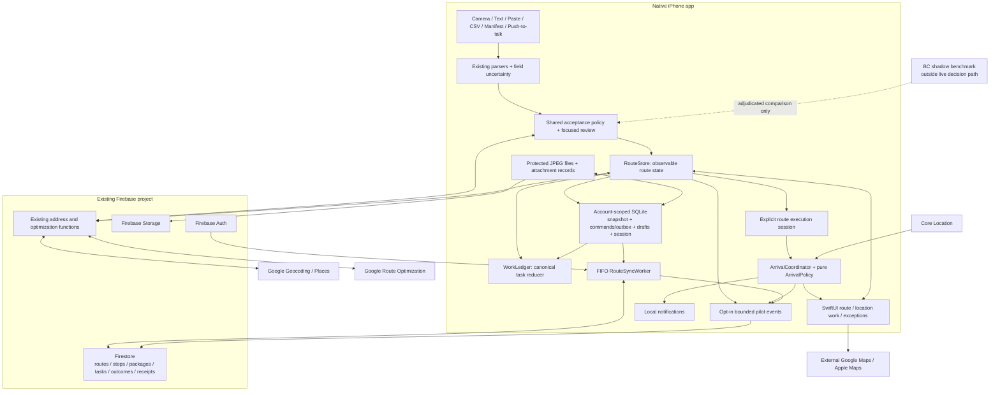
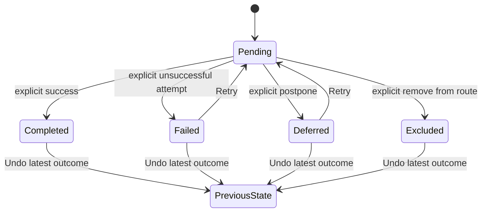
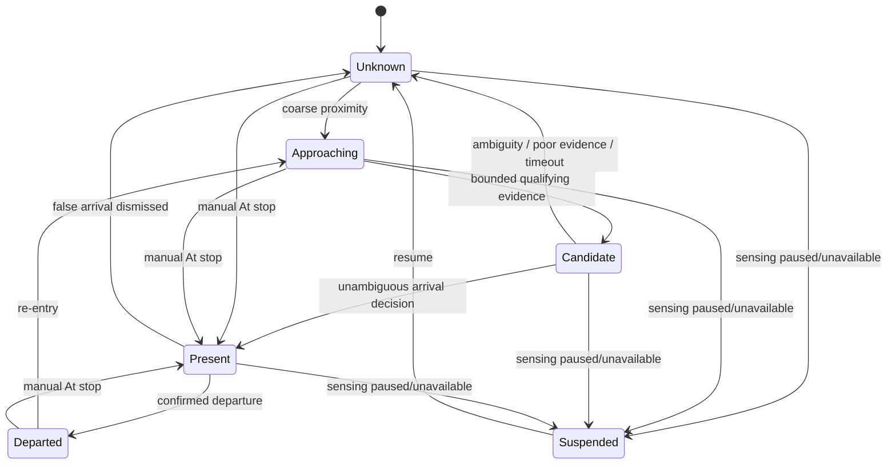
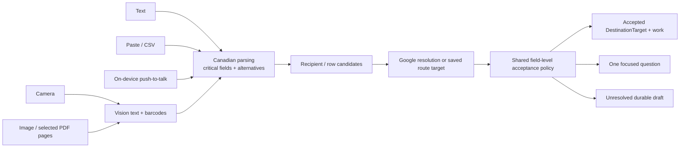
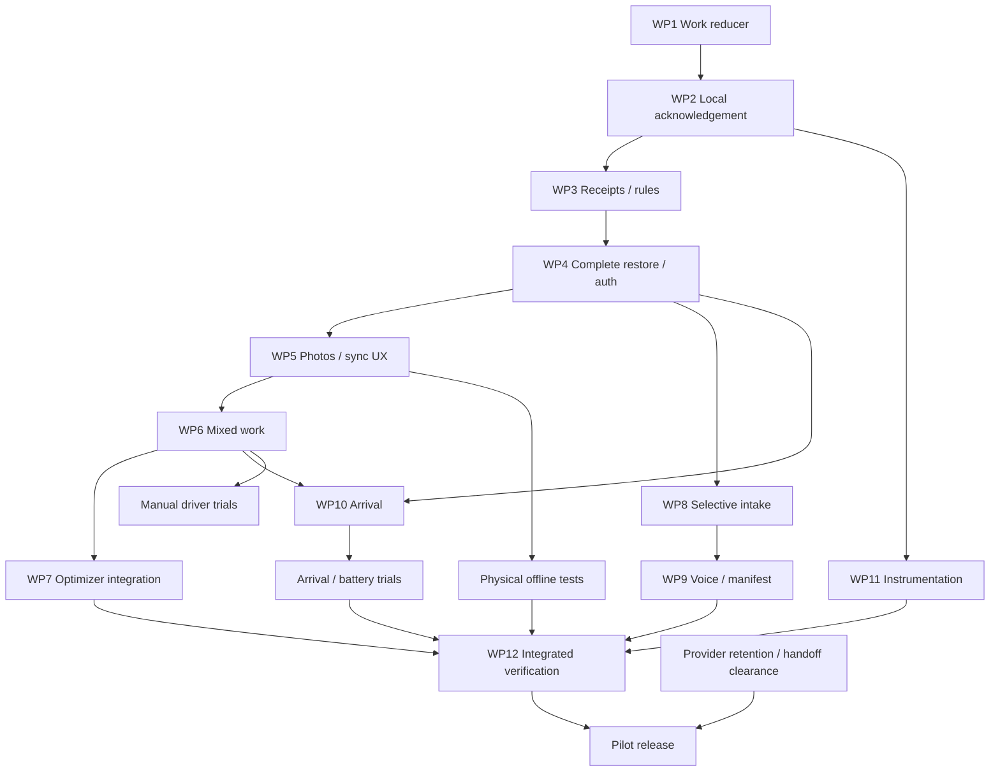

# ParcelPilot Phase 1 implementation blueprint

**Phase 1 will extend the existing SwiftUI/Firebase/Google app into a dependable location-and-work workflow. The central changes are one generalized outcome reducer, acknowledged local persistence, selective address review, and optional arrival assistance.**

I re-inspected the repository and reconciled the previous decision document with the current implementation. The existing **97 Swift package tests, 44 backend unit tests, and backend TypeScript checks pass**. Physical arrival, background execution, battery performance, and the new offline guarantees remain implementation and device-test gates.

No implementation, migrations, deployments, production changes, or paid-provider experiments were performed.

## 1. Phase 1 boundary

Phase 1 builds the following capabilities:

- Add deliveries, independent pickups, and checklist work to a location.
- Reuse camera OCR, barcode scanning, typed addresses, Places suggestions, paste, and CSV.
- Add push-to-talk address entry using on-device speech where available.
- Add bounded OCR import for printed manifest images and selected PDF pages.
- Automatically add clean, sufficiently resolved inputs; ask focused questions for material uncertainty.
- Preserve distinct units, packages, tracking identifiers, partial completion, failure, deferral, Retry, and Undo.
- Accept a proposed route explicitly.
- Start an explicit route execution session.
- Navigate using the existing external Google/Apple handoff.
- Optionally surface the location’s outstanding work using Core Location.
- Record every work outcome explicitly and durably before displaying success.
- Restore the loaded route and locally recorded work after network loss and app termination.
- Measure corrections, interaction, forgotten work, destination errors, route duration, and durability failures.

**Google remains the production address resolver and optimizer. BC Geocoder is a Phase 1 shadow comparison, with no authority over live destinations.**

Phase 1 explicitly defers:

- Android.
- Always-on listening and multiple addresses in one voice utterance.
- General voice commands.
- Cross-stop pickup-to-delivery transport dependencies, capacity, and inventory tracking.
- Task-specific time windows; existing stop-level windows remain.
- Cloud OCR, multimodal address interpretation, and handwriting guarantees.
- A reusable shared geographic correction database.
- BC-first production resolution.
- Road graphs, closure enforcement, regional routing downloads, Valhalla, and OR-Tools.
- In-app navigation.
- Automatic route reshuffling.
- Seamless concurrent editing of an active route from multiple devices.
- Signatures and mandatory proof-of-delivery photos.

The journey being validated is:

**Add work → answer only necessary destination questions → accept route → start route → navigate → see every obligation at the location → record outcomes → continue, including offline.**

The success hypothesis is that selective intake and location-aware work presentation reduce correction, stationary interaction, and forgotten obligations without increasing missed work, silent destination errors, route duration, or fragility.

**Phase 1 definition of done:** this journey works with legacy and new routes; all operational changes receive a checked local acknowledgement; the specified offline/restart/replay tests pass; arrival has a complete manual fallback; proposal safeguards cover every relevant mutation; and an instrumented physical pilot can assess the hypothesis.

## 2. Consistency decisions

The previous document contains both genuine contradictions and boundaries that would otherwise require implementation agents to invent behaviour.

| Issue | Conflicting/unclear statements | Decision | Reason | Phase |
|---|---|---|---|---|
| BC resolution | Sections 4, 6, and 14 imply BC-first production; Section 11 places the adapter in Phase 2. | Google production; BC shadow comparison only. | Existing provider models, precision assessment, provenance, and rules assume Google. A second authoritative resolver would expand pilot risk before demonstrating value. | Experiment during Phase 1 |
| Voice batch size | Section 6 proposes multiple addresses per session; Phase 1 describes a minimum on-device voice capability. | One address per push-to-talk session; repeat sessions quickly. | Avoids segmentation mistakes between unit, civic number, and subsequent addresses. | Phase 1; bulk voice deferred |
| Speech fallback | Prior document allows on-device or disclosed online transcription. | On-device only in Phase 1; text/camera fallback when unavailable. | Provides one clear privacy contract without another audio-processing path. | Phase 1 |
| Generalized outcomes | New `TaskOutcome` is proposed alongside existing delivery outcomes. | Extend the existing outcome family and collection; one reducer. | Two independent completion ledgers would break progress, Undo, and replay. | Phase 1 |
| Failure versus completion | Proposed task states do not define how failed work affects route progress; current deliveries treat failure as handled. | Failed is an explicit unsuccessful disposition, excluded from optimization until Retry. It is never displayed as successful completion. | Preserves current behaviour and distinguishes attempted work from forgotten work. | Phase 1 |
| Deferral versus completion | “All work has an outcome” could imply deferred work is finished. | Deferred remains unfinished and visible in close-out; omitted from optimization until Retry. | Preserves current skipped-work protection. | Phase 1 |
| Optional work | General tasks include required/optional work, but route eligibility is unspecified. | Optional work does not create a visit or block close-out; it remains visible when visiting and in the remaining-work summary. | Avoids optional notes accidentally extending routes. | Phase 1 |
| Pickup dependencies | Route-quality section treats pickup-before-delivery as a feasibility constraint. | Phase 1 pickups are independent obligations. Linked transport jobs cannot be created. | Current unique-stop proposals and first/main/last segmentation do not safely represent general precedence. | Deferred |
| Repeat visits/time windows | Previous task design mentions incompatible windows requiring separate visits. | Keep existing stop-level windows. A later return uses remaining work at the same stop; no task-level scheduling or repeated-visit optimizer model. | Preserves the existing optimizer contract. | Phase 1; task windows deferred |
| “Active route” | Arrival requires an explicit active route, but current Start delivering only changes view state; the first outcome activates the route. | Add a durable Start/Pause/Resume/Finish execution session. Recording an outcome never authorizes sensing. | A screen mode is not sufficient tracking consent or restoration state. | Phase 1 |
| Stale proposals | Previous report describes revision safeguards as settled; outcomes, Undo, manual reorder, and next-stop changes do not consistently increment revisions. | Extend revision coverage and acceptance validation. | Partial changes can currently escape stale detection. | Phase 1 |
| Offline durability | Previous document requires dependable loaded-route work; existing Firestore cache/journal does not establish checked durability. | Add a transactional protected local snapshot and outbox. | Current journal writes can fail silently, and restoration can select another route. | Phase 1 |
| Background sensing | Adaptive bursts could be interpreted as stopping all location acquisition between geofence wakes. | Maintain coarse updates during enabled active-route sensing; use bounded fine bursts. | When In Use background execution cannot be treated as a guaranteed geofence-only relaunch system. | Phase 1 |
| Arrival thresholds | Numeric defaults could be read as validated reliability. | Treat them as experiment defaults with abstention and manual fallback. | GPS cannot reliably distinguish every adjacent property or traffic-light wait. | Experiment during Phase 1 |
| Geographic corrections | Phase 2 adds persistent verified corrections; Phase 1 must retain manually saved corrections offline. | Save corrections on the current route only. Cross-route reuse and shared evidence remain deferred. | Satisfies the offline workflow without building a geographic learning system. | Phase 1; reuse deferred |
| Closures/access | Route objective discusses enforcing applicable closures/access restrictions. | Preserve existing supported constraints; show driver instructions and approved pins. Do not claim new closure enforcement. | External navigation and Google’s managed graph cannot be controlled by a new advisory overlay. | Deferred |
| Offline provider content | Previous plan notes 30-day coordinates and 24-hour proposals, while promising offline accepted routes. | Use explicit source policies; require confirmation of optimized-order retention rights before advertising that offline capability. | A TTL or acceptance tap does not establish storage permission. | Phase 1 release gate |
| Manifest scope | Broad manifest support could imply arbitrary documents/layouts. | Printed images and selected PDF pages using bounded row/block extraction; uncertain rows enter review. | Reuses Vision while avoiding speculative document understanding. | Phase 1 |

## 3. Current-code delta map

“Keep” below means retain working behaviour. “Migrate” means replace a specific unsafe persistence or state boundary—not rewrite the application.

| Capability | Current implementation | Keep / extend / migrate / add | Exact files/modules | Why |
|---|---|---|---|---|
| Route/stop/package identity | Schema 1; unit-aware destination identity; separate packages | Extend | [RouteModels.swift](/Users/nickkk/Documents/Projects/ParcelPilot/Packages/ParcelPilotKit/Sources/ParcelPilotKit/Model/RouteModels.swift), [Core.swift](/Users/nickkk/Documents/Projects/ParcelPilot/Packages/ParcelPilotKit/Sources/ParcelPilotKit/Model/Core.swift) | Add protocol ownership and generalized work without duplicating packages. |
| Delivery outcomes, partial completion, progress | Latest nonvoided package outcome; failed/excluded handled; skipped unfinished | Extend through one reducer | [DeliveryProgress.swift](/Users/nickkk/Documents/Projects/ParcelPilot/Packages/ParcelPilotKit/Sources/ParcelPilotKit/Delivery/DeliveryProgress.swift) | Generalize the canonical calculation while preserving legacy results. |
| General tasks | No pickup/checklist definition model | Add | Proposed `Tasks/LocationTask.swift` and `Tasks/WorkLedger.swift` inside the existing `ParcelPilotKit` source directory | Store only genuinely new work definitions. |
| Commands and local acknowledgement | `commit` returns `Void`; callers display success immediately | Migrate boundary | [Backend.swift](/Users/nickkk/Documents/Projects/ParcelPilot/ParcelPilot/Services/Core/Backend.swift), [RouteStore.swift](/Users/nickkk/Documents/Projects/ParcelPilot/ParcelPilot/Services/Core/RouteStore.swift) | Success must follow checked local commit. |
| Selected/active route restoration | Selects first open route; selection is memory-only | Extend | [RouteStore.swift](/Users/nickkk/Documents/Projects/ParcelPilot/ParcelPilot/Services/Core/RouteStore.swift), [AppServices.swift](/Users/nickkk/Documents/Projects/ParcelPilot/ParcelPilot/App/AppServices.swift) | Restore the actual active route and execution session. |
| Critical-write journal | JSON subset of operations; silent save failures; excludes route patches | Migrate internals | [SyncJournal.swift](/Users/nickkk/Documents/Projects/ParcelPilot/ParcelPilot/Services/Firebase/SyncJournal.swift) | Become the status-facing view of the transactional outbox. |
| Protected local route | No complete pinned snapshot | Add | Proposed `/Users/nickkk/Documents/Projects/ParcelPilot/ParcelPilot/Services/Core/ActiveRoutePersistence.swift` | Firestore eviction must not remove loaded work. |
| Firestore transport | Independent listeners, optimistic cache, reconciliation | Extend | [FirestoreRouteBackend.swift](/Users/nickkk/Documents/Projects/ParcelPilot/ParcelPilot/Services/Firebase/FirestoreRouteBackend.swift), proposed sibling `RouteSyncWorker.swift` | Complete-load validation, exact receipts, FIFO replay, no “unknown means success.” |
| Firebase cache | Persistent cache configured | Keep | [FirebaseBootstrap.swift](/Users/nickkk/Documents/Projects/ParcelPilot/ParcelPilot/Services/Firebase/FirebaseBootstrap.swift) | Useful transport/cache; no longer the offline guarantee. |
| Photos | Durable JPEG plus unchecked manifest; removes bytes before metadata acknowledgement | Extend/migrate metadata | [FirebasePhotoStore.swift](/Users/nickkk/Documents/Projects/ParcelPilot/ParcelPilot/Services/Firebase/FirebasePhotoStore.swift), [PackageAndPhotoViews.swift](/Users/nickkk/Documents/Projects/ParcelPilot/ParcelPilot/Features/Deliver/PackageAndPhotoViews.swift) | Preserve bytes through upload and metadata failure. |
| Authentication | Existing account/session health and reauthentication | Keep; extend lifecycle | [FirebaseSession.swift](/Users/nickkk/Documents/Projects/ParcelPilot/ParcelPilot/Services/Firebase/FirebaseSession.swift), [AppCoordinator.swift](/Users/nickkk/Documents/Projects/ParcelPilot/ParcelPilot/App/AppCoordinator.swift), [ReauthenticateControls.swift](/Users/nickkk/Documents/Projects/ParcelPilot/ParcelPilot/Features/Root/ReauthenticateControls.swift) | Same-account local recovery and awaited account teardown. |
| Vision OCR | On-device recognition, alternatives, quality checks, rotations | Keep; targeted extension | [VisionLabelReader.swift](/Users/nickkk/Documents/Projects/ParcelPilot/Packages/ParcelPilotKit/Sources/ParcelPilotKit/Labels/VisionLabelReader.swift), [LabelAnalyzer.swift](/Users/nickkk/Documents/Projects/ParcelPilot/Packages/ParcelPilotKit/Sources/ParcelPilotKit/Labels/LabelAnalyzer.swift), [LabelBlockSegmenter.swift](/Users/nickkk/Documents/Projects/ParcelPilot/Packages/ParcelPilotKit/Sources/ParcelPilotKit/Labels/LabelBlockSegmenter.swift) | Improve field-level uncertainty and manifest rows; retain processing baseline. |
| Camera/barcodes | Live scanner, barcode parsing, tracking dedupe, package finder | Keep; extend association | [LiveScannerView.swift](/Users/nickkk/Documents/Projects/ParcelPilot/ParcelPilot/Features/Scan/LiveScannerView.swift), [BarcodePayload.swift](/Users/nickkk/Documents/Projects/ParcelPilot/Packages/ParcelPilotKit/Sources/ParcelPilotKit/Labels/BarcodePayload.swift), [PackageAndPhotoViews.swift](/Users/nickkk/Documents/Projects/ParcelPilot/ParcelPilot/Features/Deliver/PackageAndPhotoViews.swift) | Retain supported-device/manual fallbacks; keep tracking-only input for explicit association. |
| Intake acceptance | Batch mode auto-adds clean scans; ordinary mode always opens confirmation | Extend | [ScanModel.swift](/Users/nickkk/Documents/Projects/ParcelPilot/ParcelPilot/Features/Scan/ScanModel.swift), [IntakeCandidate.swift](/Users/nickkk/Documents/Projects/ParcelPilot/ParcelPilot/Features/AddStops/IntakeCandidate.swift), [ReviewPolicy.swift](/Users/nickkk/Documents/Projects/ParcelPilot/Packages/ParcelPilotKit/Sources/ParcelPilotKit/Intake/ReviewPolicy.swift) | Separate acceptance policy from continuous-camera mode. |
| Address identity/matching | Unit-aware keys; interpolated points treated generously; some broad nonblocking differences | Extend | [AddressResolution.swift](/Users/nickkk/Documents/Projects/ParcelPilot/Packages/ParcelPilotKit/Sources/ParcelPilotKit/Address/AddressResolution.swift), [CanadianAddressParser.swift](/Users/nickkk/Documents/Projects/ParcelPilot/Packages/ParcelPilotKit/Sources/ParcelPilotKit/Address/CanadianAddressParser.swift) | Protect civic/unit/direction identity; distinguish missing unit from conflicting unit. |
| Manual/Places entry | Debounced autocomplete; preserves typed unit when result lacks one; always confirmation | Keep lookup; extend review | [AddStopsViews.swift](/Users/nickkk/Documents/Projects/ParcelPilot/ParcelPilot/Features/AddStops/AddStopsViews.swift), [AddressSuggestions.swift](/Users/nickkk/Documents/Projects/ParcelPilot/ParcelPilot/Features/AddStops/AddressSuggestions.swift), [AddressConfirmationView.swift](/Users/nickkk/Documents/Projects/ParcelPilot/ParcelPilot/Features/AddStops/AddressConfirmationView.swift) | Retain session tokens; compare supplied critical fields before adopting suggestion components. |
| Geocoding/expiry | Authenticated Google resolution; pending verification; coordinate refresh | Keep provider; extend invalidation | [AddressVerifier.swift](/Users/nickkk/Documents/Projects/ParcelPilot/ParcelPilot/Services/Core/AddressVerifier.swift), [resolveAddress.ts](/Users/nickkk/Documents/Projects/ParcelPilot/firebase/functions/src/resolveAddress.ts), [google.ts](/Users/nickkk/Documents/Projects/ParcelPilot/firebase/functions/src/providers/google.ts) | Target changes must invalidate outstanding proposals. |
| Draft queue | JSON drafts; save errors logged; transfer/removal not acknowledged | Migrate durability | [DraftStore.swift](/Users/nickkk/Documents/Projects/ParcelPilot/ParcelPilot/Services/Core/DraftStore.swift) | Draft survives until acknowledged transfer or explicit cancellation. |
| Paste/CSV | Existing parser, column mapping, duplicate review | Keep; extend shared policy | [BulkImport.swift](/Users/nickkk/Documents/Projects/ParcelPilot/Packages/ParcelPilotKit/Sources/ParcelPilotKit/Import/BulkImport.swift), [ImportViews.swift](/Users/nickkk/Documents/Projects/ParcelPilot/ParcelPilot/Features/AddStops/ImportViews.swift) | Reuse parsing and row identities; add manifest input. |
| Voice | Absent after targeted search | Add | Proposed `Services/Core/VoiceAddressCapture.swift`, `Features/AddStops/VoiceAddressView.swift` | Small on-device address entry adapter. |
| Arrival | One-shot planning location only | Keep one-shot; add separate coordinator | [Infrastructure.swift](/Users/nickkk/Documents/Projects/ParcelPilot/ParcelPilot/Services/Core/Infrastructure.swift), proposed `ArrivalCoordinator.swift`, `ArrivalNotificationService.swift`, and Kit `Arrival/ArrivalPolicy.swift` | Avoid interfering with continuation-based one-shot requests. |
| Background/session lifecycle | No location background mode or arrival notifications | Extend | [Info.plist](/Users/nickkk/Documents/Projects/ParcelPilot/ParcelPilot/Info.plist), [project.pbxproj](/Users/nickkk/Documents/Projects/ParcelPilot/ParcelPilot.xcodeproj/project.pbxproj), [MainTabView.swift](/Users/nickkk/Documents/Projects/ParcelPilot/ParcelPilot/Features/Root/MainTabView.swift), [AppServices.swift](/Users/nickkk/Documents/Projects/ParcelPilot/ParcelPilot/App/AppServices.swift) | Session ownership must outlive a particular screen. |
| Navigation | External handoff; memory-only return metadata; no completion on return | Keep construction; extend persistence | [NavigationLauncher.swift](/Users/nickkk/Documents/Projects/ParcelPilot/ParcelPilot/Services/Core/NavigationLauncher.swift), [NavigationHandoff.swift](/Users/nickkk/Documents/Projects/ParcelPilot/Packages/ParcelPilotKit/Sources/ParcelPilotKit/Delivery/NavigationHandoff.swift) | Preserve approved building-address/pin semantics and restore handoff focus. |
| Driver work UI | Fast delivery deck, package selection, failures, skips, Undo | Extend | [DeliveryPanel.swift](/Users/nickkk/Documents/Projects/ParcelPilot/ParcelPilot/Features/Deliver/DeliveryPanel.swift), [FocusDeliveryViews.swift](/Users/nickkk/Documents/Projects/ParcelPilot/ParcelPilot/Features/Deliver/FocusDeliveryViews.swift), [StopDetailView.swift](/Users/nickkk/Documents/Projects/ParcelPilot/ParcelPilot/Features/Stops/StopDetailView.swift) | Preserve simple delivery speed; expose mixed obligations. |
| Route start/proposal readiness | Screen-only delivery mode; applied-plan tracking | Extend | [RouteWorkspaceView.swift](/Users/nickkk/Documents/Projects/ParcelPilot/ParcelPilot/Features/Workspace/RouteWorkspaceView.swift), [PlanTracker.swift](/Users/nickkk/Documents/Projects/ParcelPilot/ParcelPilot/Features/Workspace/PlanTracker.swift) | Start must acknowledge session/snapshot; later work changes must not erase accepted order. |
| Optimization input/output | Google adapter, unique stop visits, pins, windows, deadlines | Extend eligibility/protocol | [OptimizationModels.swift](/Users/nickkk/Documents/Projects/ParcelPilot/Packages/ParcelPilotKit/Sources/ParcelPilotKit/Routing/OptimizationModels.swift), [CallableServices.swift](/Users/nickkk/Documents/Projects/ParcelPilot/ParcelPilot/Services/Firebase/CallableServices.swift), [OptimizeSheet.swift](/Users/nickkk/Documents/Projects/ParcelPilot/ParcelPilot/Features/Optimize/OptimizeSheet.swift) | Include required pending tasks and strengthen acceptance checks. |
| Backend optimizer | Package-based eligibility, segmented Google model, transactional stale check | Extend; retain algorithm | [eligibility.ts](/Users/nickkk/Documents/Projects/ParcelPilot/firebase/functions/src/optimization/eligibility.ts), [model.ts](/Users/nickkk/Documents/Projects/ParcelPilot/firebase/functions/src/optimization/model.ts), [run.ts](/Users/nickkk/Documents/Projects/ParcelPilot/firebase/functions/src/optimization/run.ts), [interpret.ts](/Users/nickkk/Documents/Projects/ParcelPilot/firebase/functions/src/optimization/interpret.ts) | Generalized work changes eligibility, not the selected solver. |
| Schemas/rules/retention | Strict schema-1 allowed fields; provider retention cleanup | Extend additively | [types.ts](/Users/nickkk/Documents/Projects/ParcelPilot/firebase/functions/src/types.ts), [validation.ts](/Users/nickkk/Documents/Projects/ParcelPilot/firebase/functions/src/validation.ts), [firestore.rules](/Users/nickkk/Documents/Projects/ParcelPilot/firebase/firestore.rules), [retention.ts](/Users/nickkk/Documents/Projects/ParcelPilot/firebase/functions/src/retention.ts) | Support protocol 2, receipts, tasks, bounded telemetry, and content policy. |
| Telemetry | OSLog categories; no product event instrumentation found | Add | Proposed `Services/Core/PilotTelemetry.swift`; extend [SettingsView.swift](/Users/nickkk/Documents/Projects/ParcelPilot/ParcelPilot/Features/Settings/SettingsView.swift) | Measure the hypothesis with opt-in, bounded data. |
| Privacy/history | Existing privacy and completed-route presentation | Extend copy/read model | [HistoryView.swift](/Users/nickkk/Documents/Projects/ParcelPilot/ParcelPilot/Features/History/HistoryView.swift), [PrivacyInfo.xcprivacy](/Users/nickkk/Documents/Projects/ParcelPilot/ParcelPilot/Resources/PrivacyInfo.xcprivacy) | Background-sensing copy must be accurate; history must distinguish delivery/pickup/checklist outcomes. |
| Demo/local fixtures | JSON backend and synthetic providers | Keep; fix acknowledgement adapter | [LocalRouteBackend.swift](/Users/nickkk/Documents/Projects/ParcelPilot/ParcelPilot/Services/Demo/LocalRouteBackend.swift), [DemoOptimizer.swift](/Users/nickkk/Documents/Projects/ParcelPilot/Packages/ParcelPilotKit/Sources/ParcelPilotKit/Routing/DemoOptimizer.swift) | Tests must not succeed on local writes production would reject. |

The design system, map renderer, sign-in design, Google provider authentication, existing quota reservation, and account-deletion architecture remain intact.

Remove only these unsafe behaviours:

- Independent package-only progress calculations after the generalized reducer is introduced.
- Success feedback before local acknowledgement.
- Treating verification exceptions as successful reconciliation.
- Silent record dropping during route decode.
- Deleting queued photo bytes before metadata acknowledgement.
- Blanket confirmation for clean input when selective acceptance is enabled.

## 4. Final Phase 1 architecture



Ownership boundaries:

| Data | Source of truth |
|---|---|
| Task meaning and effective state | The `WorkLedger` reducer specification, operating on task definitions and canonical outcomes. |
| Operational state acknowledged on this phone | Committed local snapshot plus committed pending command envelopes. |
| Server-acknowledged shared records | Firestore records and matching immutable mutation receipts. |
| UI state | `RouteStore`, materialized from that same event family. |
| Delivery task identity | Existing package ID projected into a stable delivery task ID. |
| Pickup/checklist definition | The corresponding task definition; replicated locally and in Firestore. |
| Accepted sequence | Explicit accepted/manual order mutation, subject to the retention release gate. |
| Proposed sequence | The validated optimizer proposal; it has no authority until accepted. |
| Address identity | Original supplied components plus explicit corrections/context. |
| Provider location evidence | Provider response with source, precision, and retention policy. It is evidence, not proof of access. |
| Driver pin/access correction | Explicit driver-saved route data. |
| Presence | Current session’s fresh/manual arrival decision. Restored cursor is historical context. |
| Task success | Explicit outcome event only. Presence and navigation never imply success. |
| Queued photo bytes | Protected local JPEG until verified upload and metadata acknowledgement. |
| Uploaded photo bytes | Firebase Storage. |
| Sync status | Local outbox lifecycle and server receipts. |
| Pilot measurements | Opt-in telemetry records; they never drive task state. |

These are replicas and projections of the same operational records. There is no separate task-completion database.

## 5. Domain model

### Entities and architecture-relevant fields

| Entity | Fields and relationships |
|---|---|
| **Route** | Existing ID, status, service date/time zone, endpoints, constraints, order provenance, `inputRevision`; add schema/protocol 2 support, writer installation ID, last command ordinal, migration state, and accepted-order mutation reference. |
| **Stop** | Existing ID, route relationship, unit-aware destination key, sequence, pin, window, aggregate service duration, notes; add destination version. A stop remains an operational destination. |
| **DestinationTarget** | Supplied address identity; original components; explicit corrections/context; building point; optional approved driver access point; Google place ID; precision/source/expiry; resolution state; version. Initially an embedded stop value, not a new collection. |
| **Package** | Existing ID, stop ID, tracking ID/key, recipient, vehicle location, size, notes, timestamps. Represents an existing delivery item. |
| **LocationTask** | ID, stop ID, raw kind, required flag, title/instructions, order rank, definition version, timestamps; optional package/reference linkage. Delivery tasks are projected; only pickup/checklist definitions are persisted. |
| **TaskOutcome** | Existing outcome family extended: ID, task ID, optional package ID, stop ID, action, reason/note, photo references, actor UID/installation, source, observed timestamp, command ID/ordinal, predecessor outcome ID, void metadata. |
| **VisitCursor** | Visit ID, route/session ID, location/group member stop IDs, last presence transition, manual/automatic source, surfaced-task IDs, departure-warning marker, suppression state. Local only. |
| **RouteExecutionSession** | Session ID, route ID, active/paused/ended state, start/resume/end times, arrival preference, selected work location, last navigation handoff. Local durable state; route status/start/end also synchronize. |
| **RouteProposal** | Existing request ID, route ID, revision, visits, exclusions, unassigned work, constraints, expiry/provider; add protocol version and an input digest covering required work heads, destination versions, and fixed next. |
| **RouteMutation** | Stable mutation ID, action-group ID, route/UID/writer, ordinal, expected previous ordinal, exact operations, revision effect, payload digest, local acknowledgement time, replay state. |
| **MutationReceipt** | Stable mutation ID, route/UID/writer, ordinal, digest, resulting route revision. Created atomically with the cloud mutation. |
| **Attachment** | Existing photo ID and linkage; local path/hash, byte count, upload phase, attempts/error, storage object identity, metadata mutation ID. |

### Identity

- Keep existing route, stop, package, outcome, and photo IDs.
- Delivery task ID is **`delivery_<packageID>`**.
- Pickup/checklist IDs use the existing stable-ID generator.
- One logical driver action gets an action-group ID.
- Each remote-sized command gets a mutation ID.
- Each outcome gets its own stable ID before local commit.
- IDs survive restart and replay; retries do not generate replacements.

The underscore format fits the current ID rules.

### Canonical reducer

Introduce `WorkLedger`.

It:

1. Projects packages into required delivery tasks.
2. Reads persisted pickup/checklist definitions.
3. Normalizes schema-1 and schema-2 outcomes.
4. Applies voids and valid causal event order.
5. Produces task states, required-work progress, stop status, and optimization eligibility.

`DeliveryLedger` becomes a compatibility facade that translates this result into existing package status APIs. It must not retain an independent calculation.

Swift and TypeScript implement the same reducer contract and consume shared expected-result fixtures. They do not store separate authoritative status fields.

### Outcome vocabulary

| Stored action | Generalized meaning |
|---|---|
| `delivered` | Delivery completed. |
| New `completed` | Pickup/checklist completed. |
| `failed` | Explicit unsuccessful attempt. |
| `skipped` | Deferred. |
| `requeued` | Retry; restore pending work. |
| `excluded` | Explicitly remove the obligation from further attempts on this route. |
| Existing one-time void | Undo the referenced outcome. |

No new collection named `taskOutcomes`.

### Required, optional, instructions, and ordering

- Deliveries remain required.
- Pickups/checklist items default to required.
- Optional checklist work is supported explicitly.
- Instructions are displayed before the relevant action.
- An instruction requiring its own acknowledgement is represented as a required checklist item.
- Phase 1 has no task dependency graph.
- Default presentation order: required instructions/checks, pickups, deliveries, optional work.
- Order rank controls presentation, not optimizer precedence.
- No automatic inference of weights, inventory, or per-task service duration.

### Compatibility

Legacy routes and outcomes remain readable without backfilling delivery task documents.

A schema-2 route requires a compatible writer. Old clients cannot edit promoted routes while ignoring pickups/checklists. Unpromoted historical routes retain their existing representation.

Unknown task kinds are decoded safely:

- Required unknown kind: visible unsupported work; affected completion/optimization is blocked.
- Optional unknown kind: visible unsupported optional work.
- Neither disappears through `try?` decoding.

## 6. State machines

### Task state



`PreviousState` means reduction of the remaining nonvoided history—not a separately stored status.

Every task transition uses the same persistence rule: **checked local transaction first, then UI update; cloud sync later**.

| Transition | Trigger/effect | Reversibility and invalid transitions | Offline/restart behaviour |
|---|---|---|---|
| Pending → completed | Driver presses Delivered/Pickup complete/Done; append outcome. | Undo latest outcome. Duplicate tap suppressed while committing. | State and event survive restart. |
| Pending → failed | Driver selects a concise failure reason; append failure. | Retry or Undo. Completion requires Retry first if already failed. | Failure remains visible and handled. |
| Pending → deferred | Explicit Defer; append skipped/deferred event. | Retry or Undo. Departure alone cannot trigger it. | Remains unfinished in close-out. |
| Pending → excluded | Explicit route-removal disposition with reason. | Undo latest event. Never inferred from route finish. | History and reason survive. |
| Failed/deferred → pending | Retry appends requeued. | Undo Retry restores previous state. | Eligible for remaining-route optimization after sync. |
| Latest outcome → previous state | Undo references current latest outcome IDs. | Stale Undo cannot void newer work or another task’s event. | Void intent survives restart/replay. |
| Any → conflict/unsupported | Invalid branch, mismatched duplicate, missing definition, unsupported required kind. | Resolve explicitly; do not choose by clock. | Preserve records; affected action/proposal blocked. |

Completion before sensed arrival is valid. It changes work only and suppresses redundant prompts.

### Visit state



| Transition | Trigger | Persistence, UI effect, and reversal | Offline/restart behaviour |
|---|---|---|---|
| Unknown → approaching | Coarse fix/approach condition. | Transient; begin bounded fine acquisition. No work-state change. | Works without backend; recomputed after restart. |
| Approaching → candidate | Fresh, sufficiently accurate nearby fixes. | Transient; evaluate dwell, movement, separation. | No server write. |
| Candidate → present | Policy accepts one location. | Persist visit cursor/dedup marker, then surface work. Dismissible. | Local presentation works offline; restart does not treat cursor as fresh proof. |
| Any available state → present | Driver selects At stop for a location. | Persist manual cursor; show work immediately. No outcome. | Works without location permission or connectivity. |
| Candidate/approaching → unknown | Burst timeout, drive-by, poor/stale fix, departure from approach area. | Stop fine sampling; retain manual path. | No outstanding work changes. |
| Present → unknown | Dismiss false arrival. | Persist suppression; no immediate repeated prompt. | Suppression survives restart until new entry/explicit target selection. |
| Present → departed | Fresh outward evidence with hysteresis. | Persist departure/warning marker; warn once if required pending work remains. | No task outcome or reordering. |
| Departed → approaching/present | Return with fresh evidence or manual arrival. | New visit ID; surface remaining work only. | Completed tasks stay completed. |
| Any → suspended | Pause, permission loss, disabled sensing, route end. | Stop services/conditions; preserve cursor and all work. | Manual workflow remains available. |
| Suspended → unknown | Explicit session resume or permitted foreground restoration of an active session. | Revalidate permission/targets; never restore presence confidence. | Requires fresh evidence. |

Invalid transitions include:

- Arrival → task completed.
- Departure → deferred.
- Navigation return → completed.
- Nearby coordinates → merged destination identities.
- Restarted cursor → current confirmed presence.

### Route execution and progress

Execution:

`planning → active ↔ paused → ended`

The existing cloud route status remains planning/active/completed/archived. Pause is an execution-session condition; it does not falsely complete the route.

| Trigger | Effect |
|---|---|
| Accept proposal | Save accepted order; execution remains stopped until Start route. |
| Start route | Acknowledge complete local snapshot/session first; set route active; start optional sensing. |
| Pause | Stop sensing/notifications; retain work and accepted order. |
| Resume | Restart session-owned sensing if enabled and permitted. |
| Finish | Show required pending/deferred/failed/excluded work and sync problems; require explicit close-out acknowledgement. Never manufacture outcomes. |
| Archive | Existing history action; stop all route monitoring. |
| Undo after finish | Require explicit Reopen route first; recompute summary rather than rewriting outcomes. |

Derived progress:

- **Successful:** required completed tasks.
- **Handled:** completed, failed, excluded.
- **Unfinished:** pending and deferred.
- **Optional:** separately summarized.
- **Needs attention:** unsupported/conflicting work and blocked sync.

A stop can be handled without every task succeeding. The UI must say that plainly.

### Offline mutation lifecycle

`locally committed → pending → submitting → acknowledged`

Branches:

- Network/auth ambiguity → pending.
- Validation/writer/revision rejection → blocked.
- Duplicate with matching receipt → acknowledged.
- Duplicate ID with different digest → conflict.

Submitting is not a success state. App termination returns an unacknowledged submission to reconciliation.

## 7. Persistence and migration plan

### Local persistence

Add an actor-isolated `ActiveRoutePersistence` using platform SQLite3.

Use:

- WAL.
- `synchronous=FULL`.
- Checked encode, statement, and commit errors.
- Foreign-key/invariant validation.
- Versioned snapshot encoding.
- Account-scoped storage.
- File protection available after first device unlock.
- Exclusion from iCloud backup.

SQLite FULL in WAL mode provides the appropriate checked transaction boundary for normal process termination/restart. It is not a promise against device destruction or arbitrary filesystem corruption. [SQLite durability](https://sqlite.org/pragma.html#pragma_synchronous)

Keep a small schema:

| Local table | Purpose |
|---|---|
| Route snapshots | Confirmed generation plus protected materialization. |
| Mutations | Exact commands, IDs, ordinals, digest, sync state. |
| Drafts | Unresolved intake and minimal critical excerpts. |
| Attachments | Photo metadata and lifecycle. |
| Session/meta | Selected route, active session, writer identity, next ordinal, migrations, notification markers. |
| Pilot events | Bounded optional telemetry queue. |

There is no persisted task-status table.

### Local acknowledgement

For Delivered, Pickup complete, Done, Defer, Retry, Undo, task creation, accepted order, and route edits:

1. Validate against the current reducer.
2. Allocate stable IDs and command ordinals.
3. Build the exact operations and revision effects.
4. In one SQLite transaction, save commands, updated materialization, and relevant session/draft changes.
5. Commit successfully.
6. Publish through `RouteStore`.
7. Display success/Undo.
8. Schedule cloud sync.

Proposed boundary:

```swift
func commit(_ command: RouteCommand) async throws -> LocalCommitAck
func restoreActiveRoute() async throws -> RestoredRoute?
func pinCompleteSnapshot(_ snapshot: RouteSnapshot) async throws
```

If commit fails:

**“Couldn’t save on this iPhone. Free space or retry.”**

No success toast, advancement, draft deletion, or implied completion.

### Protected loaded-route contract

“Ready offline” means the local store contains a complete validated generation of:

- Current/accepted sequence.
- Addresses and unit distinctions.
- Access notes and required instructions.
- Packages and barcode/tracking identifiers.
- Pickup/checklist definitions.
- Canonical outcomes and pending commands.
- Task state/progress calculation inputs.
- Eligible navigation targets and their source policies.
- Driver pins/corrections.
- Route endpoints/constraints.
- Pending photo metadata and bytes.
- Selected route, active session, and handoff cursor.

It does **not** guarantee:

- Offline basemap tiles.
- Fresh traffic or estimates.
- New provider address verification.
- New optimization.
- Undownloaded remote photos.
- External navigator connectivity or routing capability.

Firestore caches active data, can evict unused data, and uses last-write-wins for competing document changes. Those behaviours are useful but insufficient as this contract. [Firestore offline behaviour](https://firebase.google.com/docs/firestore/manage-data/enable-offline)

### Firestore changes

Preserve:

`users/{uid}/routes/{routeID}/{stops,packages,outcomes,photos}`

Add:

- `tasks`: pickup/checklist definitions only.
- `mutationReceipts`: immutable acknowledgement records.
- Additive route protocol/ownership fields.
- Additive outcome fields.
- Minimal opt-in pilot-event storage under the existing user namespace.

Route schema 2 is also the writer-protocol boundary; do not add a redundant independent workflow-version system.

Every schema-2 mutation batch contains:

- Exact child operations.
- Minimal route patch.
- Writer and command-ordinal advance.
- Exactly one `inputRevision` increment when routing inputs change.
- A fresh receipt with the payload digest.

Rules reject:

- Wrong UID/writer.
- Unexpected base ordinal/revision.
- Unmarked legacy writes to promoted routes.
- Mutating existing receipts.
- Changing an immutable outcome beyond its permitted one-time void.

Large driver actions remain one local action. Persist their remote subcommands together in the same local transaction. Initially cap outcome subcommands at **five outcomes**, and intake subcommands at **five rows**, to keep rule-access budgets bounded. Route-order writes may use a larger tested batch because they share route/receipt checks. Validate these bounds in emulator tests before increasing them.

### Ordering, replay, and conflicts

Phase 1 supports **one active writer installation per promoted route**.

- The writer receives ownership during online bootstrap/promotion.
- A previously initialized writer continues offline.
- Another device may read.
- Transfer requires online reconciliation and an explicit handover.
- Lost-device recovery invalidates the previous writer; returning old-device commands require resolution, not silent overwrite.

New outcomes order by persisted route command ordinal and within-command index, with predecessor references. Device clocks are descriptive.

Legacy outcomes retain their existing `(recordedAt, ID)` semantics. Schema-2 commands form the subsequent generation.

Replay:

1. One FIFO worker per route.
2. Reconcile prior SDK pending writes.
3. Read receipt from server.
4. Matching ID/digest: acknowledge locally.
5. No receipt: submit original batch.
6. Duplicate rejection: read receipt again.
7. Any read/network/auth uncertainty: retain pending.
8. Different digest or incompatible writer/revision: block.
9. Fold receipt/confirmed state and outbox acknowledgement in one local transaction.

Firestore batches are atomic; client transactions cannot be relied on offline. [Firestore atomic operations](https://firebase.google.com/docs/firestore/manage-data/transactions)

A rejected command blocks dependent replay but does not erase local work. Optimization waits until relevant input mutations reconcile.

### Photos

Retain the existing encoder, Storage adapter, and storage paths.

- Re-encode without EXIF.
- Durably install bytes before committing attachment metadata.
- Use stable photo ID and content hash.
- Track queued/uploading/uploaded-awaiting-metadata/blocked/acknowledged.
- Keep bytes until upload identity and metadata receipt are acknowledged.
- Retry metadata after an upload-complete crash.
- A failed optional photo never reverses delivery.
- A missing local file becomes a visible attachment error.
- Do not treat object existence alone as proof of matching content.

### Migration and upgrade

1. Deploy additive reader/rules/backend support first.
2. Historical schema-1 routes remain untouched.
3. Before promoting an open route, reconcile existing SDK writes/journal entries.
4. Online promotion acquires the writer and freezes legacy writes in a recoverable preparing state.
5. Fetch all required collections; validate decoding, references, and coherent generation.
6. Commit the complete local snapshot.
7. Finalize protocol 2 and command ordinal initialization.
8. Only then enable generalized task creation.

A crash during preparing resumes migration; it does not reset or delete the route.

Import old drafts, photo manifests, and journal entries once, using persistent import markers and existing IDs.

The old journal omits some route operations. Do not fabricate an “exact replay.” Verify recoverable legacy events against server data and preserve unresolved entries for explicit repair.

An upgrade of an already protected schema-2 route restores offline immediately. An offline upgrade from the old cache may restore available work, but must not falsely label that incomplete cache Ready offline.

### Rollback

Feature flags can disable new task creation, voice, manifest OCR, selective auto-add, or sensing.

They cannot disable:

- Reading existing generalized tasks.
- The reducer.
- Local acknowledgement.
- Receipt replay.

An old binary is not a safe editing rollback for promoted routes. Rollback means a compatible build with features disabled, not schema downgrade.

## 8. Address and input pipeline



### Input scope

| Input | Phase 1 behaviour |
|---|---|
| Camera | Existing label pipeline, manual shutter/fallback, stable-frame processing, brief Added feedback and Undo. |
| Text | Existing parser and autocomplete; explicit Add initiates resolution. |
| Paste | Existing line/block parser; clean rows add, uncertain rows remain in review. |
| CSV | Existing column mapping and row identities; explicit bulk Add once, no per-clean-row confirmation. |
| Manifest | Printed image/PDF-page extraction into address blocks/rows. Process one page at a time, maximum 10 selected pages or 200 candidate rows per import. Larger documents are split visibly. These are resource bounds, not recognition guarantees. |
| Barcode | Associate tracking data with the selected recipient/row/package. A tracking-only barcode cannot resolve an address. |
| Voice | One address per push-to-talk session; final transcript enters the same parser/policy. |

Manifest column/row ambiguity requires review. Do not cross-join an address from one row with another row’s tracking ID.

### Field-level acceptance policy

**Automatically accepted**

All of the following must hold:

- One unambiguous recipient/address row.
- Civic number is exact and not materially uncertain.
- Street identity agrees, including supplied direction/type.
- Supplied unit is preserved and not contradicted.
- Supplied municipality/province/country do not conflict.
- Supplied postal code does not materially conflict.
- Missing context is filled only from explicit route context.
- Exactly one acceptable building-level target remains.
- Google rooftop/building precision or an explicit valid saved driver target.
- No partial-match signal, competing critical interpretation, or unresolved critical difference.
- No tracking duplicate.
- Local commit succeeds.

**Accepted with a nonblocking warning**

Examples:

- Google omits the unit, but the supplied unit is preserved.
- Postal formatting changes without changing its value.
- Punctuation, capitalization, accents, or equivalent street abbreviations normalize.
- Postal code is absent, but the supplied identity and explicit municipality/context yield one sufficiently precise match.
- A building point is available but no entrance has been verified.

Warnings must not claim an entrance was validated.

**Review required**

Examples:

- Civic alternatives such as 123 versus 128.
- Unit ambiguity or a returned conflicting unit.
- East/West or meaningful street-type conflict.
- Supplied municipality/postal disagreement.
- Sender/recipient ambiguity.
- Several plausible destinations.
- Range-interpolated/coarse point.
- Critical truncation or an inferred missing digit.
- A Places selection materially conflicts with supplied text.

Ask the unresolved question directly: **“Unit 204 or 240?”**, **“123 or 128?”**, or **“Which recipient address?”**

Do not clear all uncertainty because the driver edited one field. Store which fields were explicitly resolved.

**Unresolved**

- No usable destination.
- Postal-only/PO-box/rural description without a physical target.
- Missing critical information that context cannot resolve.
- Provider unavailable/offline.
- Unsupported manifest structure.

Save a durable draft with tracking association and minimal address excerpt. Do not place it into a supposedly verified route silently.

### Critical precision changes

- `rangeInterpolated` is not automatic building-level acceptance.
- A missing provider unit differs from a conflicting provider unit.
- Street-direction differences are material.
- Municipality substitutions are not globally nonblocking.
- Initial semantic municipality-alias policy is conservative; new aliases require benchmark evidence.
- Refreshing/changing a destination target increments its version and invalidates proposals as appropriate.

### Duplicates

- Same tracking identifier: show existing package; do not add again.
- Same exact destination, different tracking identifiers: distinct packages at the same stop.
- Same building, different units: distinct stops/tasks.
- Same address without tracking data: suppress repeated frames in one capture session; deliberate later Add creates another package.
- Repeated manifest row: flag for an explicit keep/remove choice.

### Vision

Retain accurate on-device recognition and current language-correction default.

Do not add `customWords` while claiming they improve the existing correction-disabled request: Apple says that setting is ignored when language correction is disabled. A vocabulary-enabled OCR variant is an experiment, not a default change. [Vision custom vocabulary](https://developer.apple.com/documentation/vision/vnrecognizetextrequest/customwords)

### Voice

- Tap to start; tap to stop.
- Maximum 20-second session.
- Show partial transcript as provisional.
- Process only final/stopped recognition.
- Request microphone/speech access in context.
- Check recognizer availability and `supportsOnDeviceRecognition`.
- Set `requiresOnDeviceRecognition=true`.
- If unavailable, offer Type or Scan; no silent network transcription.
- Preserve alternatives for civic/unit numbers and street homophones.
- Recognize explicit unit phrases separately from civic numbers.
- Contextual vocabulary uses the explicit route area and a bounded list of already supplied street names; at most 100 short phrases.
- Hints cannot override contrary critical evidence.
- Cancellation discards transcript/audio and creates no work.
- Backgrounding, interruption, or navigation handoff stops capture.
- Audio stays in memory and is never retained or uploaded.
- A correct offline transcript can be saved as a verification-pending draft.

On-device support is device/language dependent, and contextual strings are hints rather than correctness guarantees. [On-device recognition](https://developer.apple.com/documentation/speech/sfspeechrecognizer/supportsondevicerecognition), [contextual strings](https://developer.apple.com/documentation/speech/sfspeechrecognitionrequest/contextualstrings)

### BC Geocoder decision

**Phase 1 shadow comparison only.**

Use a research harness, outside the driver’s runtime decision path:

1. Select consented/adjudicated benchmark cases.
2. Obtain the Google result through the existing permitted benchmark path.
3. Query BC once for each unique BC civic address.
4. Compare identity, descriptor, precision, disagreement, and adjudicated destination correctness.
5. Retain case IDs and comparison categories; minimize raw address retention.

No BC request occurs during ordinary live intake. No shadow result replaces a destination or adds latency to Add.

Include at least the previously proposed 200 difficult local destinations plus established-area controls. Production adoption is a later decision based on that evidence.

## 9. Arrival-sensing design

### Ownership and permission

`AppServices` owns a dedicated `ArrivalCoordinator`; it does not live in `DeliveryPanel.onAppear`.

Keep the existing one-shot planning `LocationService` separate.

Use:

- When In Use authorization.
- Explicitly started active route.
- Optional arrival assistance.
- `UIBackgroundModes: location`.
- Foreground-started background updates.
- `CLBackgroundActivitySession` on iOS 17+.
- Conditional service-session support on newer iOS where appropriate.
- A dedicated manager for coarse/fine updates.
- `CLMonitor` conditions for approach/departure assistance.
- Local notifications; no APNs service.

Apple’s background session keeps an authorized app in use, but does not establish uninterrupted arrival delivery after termination. [Background activity session](https://developer.apple.com/documentation/corelocation/clbackgroundactivitysession-3mzv3), [background updates](https://developer.apple.com/documentation/corelocation/handling-location-updates-in-the-background)

### Lifecycle

1. **Start route:** acknowledge snapshot/session; then enable the chosen sensing preference.
2. **First enable:** explain background use while the route is active; request When In Use and notification permission separately.
3. **Driving:** maintain coarse location updates and rolling approach conditions.
4. **Approach:** start a bounded fine burst.
5. **Arrival:** evaluate evidence; persist presentation/dedup cursor; surface work.
6. **At location:** reduce acquisition after presentation; retain departure detection.
7. **Departure:** verify outward evidence; warn once for pending required work.
8. **Pause/end/sign-out/account switch:** stop updates, remove conditions, invalidate sessions, cancel route notifications.
9. **Reopen:** restore work first; restore only an explicitly active, enabled session after permission/target checks. Presence returns to unknown.
10. **No eligible pending work:** stop futile monitoring.

### Rolling set

At most:

- Next eight distinct eligible locations in accepted order, including fixed next.
- Eight nearest additional locations with required pending work.
- One current-location departure condition.

Deduplicate by explicit building identity where appropriate, preserving every stop/unit/task ID. Never group solely by proximity.

Recompute after:

- Work state change.
- Accepted/manual order change.
- Next-target change.
- Destination edit/expiry.
- Foreground restore.
- Meaningful displacement; initial default 500 metres.

This stays below the 20-condition platform limit. [Region monitoring](https://developer.apple.com/documentation/corelocation/monitoring-the-user-s-proximity-to-geographic-regions)

### Experiment defaults

| Mode/evidence | Initial value |
|---|---|
| Coarse driving | Hundred-metre desired accuracy; 50-metre movement filter. |
| Approach condition | Approximately 300-metre radius. |
| Coarse approach trigger | Approximately 500 metres. |
| Fine acquisition | Ten-metre desired accuracy; five-metre movement filter; maximum 60 seconds. |
| Low Power fine burst | Maximum 30 seconds. |
| Fix age | At most 10 seconds. |
| Horizontal accuracy | Valid and at most 30 metres. |
| Candidate radius | Initial 40 metres, subject to target type. |
| Dwell | Two qualifying fixes over approximately 10 seconds. |
| Speed | Below approximately 2.5 m/s, or equivalent displacement evidence. |
| Departure | Outside arrival area plus initial 80-metre hysteresis, sustained across fresh outward evidence. |

These are experiment defaults, not probabilities or proven performance.

Do not enlarge the acceptance radius to compensate for poor accuracy.

Use geography and uncertainty overlap first. Current navigation target/accepted next are tie-breakers, not permission to ignore another plausible address.

### Battery behaviour

Keep coarse updates between fine bursts. Disable automatic location pauses for this maintained When In Use manager, and lower acquisition accuracy instead.

Apple warns that an automatic pause under When In Use can end access until relaunch. The design must not assume it can stop all acquisition and reliably restart itself later. [Automatic pauses](https://developer.apple.com/documentation/corelocation/cllocationmanager/pauseslocationupdatesautomatically)

Fine updates end after:

- Accepted arrival.
- Timeout.
- Departure from approach area.
- Poor evidence.
- Pause/end.
- Permission loss.

Measure coarse-mode seconds, fine-mode seconds, burst counts, Low Power status, temperature warnings where available, and battery difference on matched routes.

### Presentation and failure behaviour

| Situation | Behaviour |
|---|---|
| Foreground, no active modal | Focus the location work panel. |
| Capture/review/error modal active | Queue the focus change; do not interrupt input. |
| External navigator/background | One local notification; tap opens work. |
| Several distinct plausible addresses | “Choose nearby stop”; no asserted arrival at one address. |
| Apartment building | Show unit groups together only when identity/target supports it. |
| Drive-by/traffic-light uncertainty | Abstain or present ambiguity; never complete work. |
| Reduced accuracy | Disable automatic confirmation and region dependence; manual At stop. |
| Poor/stale fixes | End burst; manual fallback. |
| Notification denied/Focus | Foreground/manual workflow remains complete. |
| Force-quit/system termination | No arrival guarantee until reopening. Work survives. |
| Permission changed | Reconcile on foreground/callback; stop sensing when unavailable. |
| Low Power Mode | Shorter bursts and potentially delayed assistance. |
| Expired/coarse target | No automatic confirmation; manual location remains accessible. |

Reduced accuracy cannot be treated as a larger geofence solution. [Accuracy authorization](https://developer.apple.com/documentation/corelocation/cllocationmanager/accuracyauthorization)

Notification content shows counts and a useful location label, excluding names, access codes, tracking IDs, and detailed instructions. Taps validate current UID, route, session, and remaining work.

## 10. Driver UX

Keep route-as-home, existing map/panel structure, and thumb-reachable actions.

| Screen/state | Driver sees | Primary action | Secondary action | Automatic behaviour / hidden information |
|---|---|---|---|---|
| Route preparation | Work list, review count, endpoints/constraints, delivery area | Add work | Optimize | Hide telemetry/provider controls. |
| Add work | Scan, Type, Speak, Paste/Import; work type defaults to delivery | Chosen input | Cancel | Keep task metadata minimal. |
| Clean input | Brief Added feedback, package/work count | Continue adding | Undo | No confirmation form. |
| Questionable input | Original critical excerpt and one question | Resolve field/candidate | Save for later | Hide numerical confidence and unrelated fields. |
| Review queue | Unresolved work and reason | Resolve next item | Remove deliberately | Never silently discard offline drafts. |
| Proposal | Order, exclusions/unassigned work, estimates, material changes, fixed next | Accept route | Keep current order | No unsupported savings claim. |
| Ready | Accepted/manual route and offline readiness | Start route | Arrival assistance preference | Start is a durable action. |
| Driving | Next address/unit/access note, outstanding work count | Navigate | At stop / choose next | No dashboard or long configuration form. |
| Navigation return | Same destination and remaining work | Relevant work action | Navigate again | No implied completion. |
| At location | Required instructions, pickup/checklist obligations, deliveries, unit groups | Explicit work outcome | Exception / Leave for now | All obligations visible; no blanket mixed-work completion. |
| Sync attention | Small persistent saved-locally/attention status | Continue local work | Resolve/retry sync | Do not ask driver to redeliver recorded work. |
| Close-out | Pending/deferred/failed/excluded work and sync/photo problems | Finish after review | Retry/reopen work | Hide decorative performance totals. |

### Work-specific behaviour

| Work at location | Behaviour |
|---|---|
| One delivery | Preserve one-tap Delivered plus Undo. At stop is not a prerequisite. |
| Several deliveries, one address/unit | Existing selection defaults and Delivered selected action; partial state remains. |
| Delivery plus pickup | Pickup visible above package detail; separate Pickup complete and Delivered actions. After either action, remaining work stays prominent. |
| Pickup only | Pickup title/reference/instructions and one-tap Pickup complete; failure/defer available. |
| Checklist | Explicit Done per item; optional items labelled optional. |
| Multiple units | Clear unit groups. Bulk delivery acts only on explicitly selected packages within the intended unit scope. |
| Failed delivery | Concise reason, saved outcome, Retry/Undo. Failed is not “delivered.” |
| Deferred pickup | “Deferred—still unfinished”; Retry restores actionable work. |
| Required instructions | Visible before relevant action; separate acknowledgement only when represented as checklist work. |
| Optional note | Brief preview/details; no extra confirmation tap. |
| Leaving with pending work | One reminder; foreground sheet offers Continue to another stop, Defer selected work, or Stay. |
| Returning later | Only remaining work is actionable; completed work available in history/details. |

**Continue to another stop does not defer work.** It sets an explicit next target. The unfinished pickup remains pending and can be included in reoptimization.

A false arrival can be dismissed without changing sequence, target, or outcomes.

Accessibility requirements:

- Minimum existing touch targets; no gesture-only operational action.
- VoiceOver announces address, unit, obligations, state, and sync distinction.
- Dynamic Type does not hide pickup/required-work counts.
- Colour is never the sole state indicator.
- Undo and exception actions remain accessible.
- Automatic presentation does not demand interaction while moving.

## 11. Optimization integration

### Eligibility

A stop is eligible when:

- At least one **required pending** task exists.
- Destination protection allows optimization.
- The stop has usable provider/driver location evidence or an eligible place ID.
- Required work is supported and nonconflicting.

| Work state | Included? |
|---|---|
| Required pending delivery/pickup/checklist | Yes. |
| Completed | No. |
| Failed | No, until Retry. |
| Deferred | No, until Retry. |
| Excluded | No. |
| Optional-only | No. |
| Unresolved destination | No; explain exclusion. |
| Required unsupported/conflicting work | Block affected planning; never silently omit. |

Keep one optimizer visit per eligible stop. Independent pickup/checklist work uses the existing generic stop-visit representation. It does not create a fake paired transport shipment.

Keep aggregate stop service duration. Do not sum invented per-task estimates.

### Revision safeguards

Increment `inputRevision` for:

- Package/task addition/removal.
- Required-status change.
- Outcome, Retry, Defer, Exclude, Undo.
- Destination/version change.
- Window, duration, pin, endpoint, or constraint change.
- Manual order change.
- Explicit next-target change.
- Accepted order change.

Do not increment for presence, telemetry, or optional photo upload metadata.

All commands advance the separate command ordinal for snapshot coherence.

Proposal validation happens:

1. Before provider request against synchronized inputs.
2. Server-side before reading.
3. Server-side after solving.
4. Client-side when displaying.
5. Again inside the local acceptance command.

Check revision, input digest, target versions, coverage, unique visits, pins, fixed next, windows/deadlines, expiry, and unresolved work.

Acceptance stores the proposal’s original computed revision and the acceptance mutation reference. `PlanTracker` uses that accepted-order provenance; subsequent outcomes may stale estimates without erasing the accepted sequence.

### Requested example

1. Driver accepts a route containing Stop A with three deliveries and one pickup.
2. Start route commits the execution session.
3. Three delivery outcomes commit locally.
4. Required pickup remains pending; A is partial.
5. A remains current until an explicit next-target action or its remaining work is handled.
6. Driver leaves. Arrival sensing warns once; it writes no deferral.
7. Driver presses Continue to B.
8. That command persists B as next target and increments revision.
9. A’s pickup remains pending.
10. Driver requests reoptimization while stationary.
11. After relevant commands synchronize, optimizer input includes A for pickup and B as fixed next.
12. Proposal preserves B first and schedules A as remaining work.
13. Driver accepts or rejects; existing order remains until acceptance.

Alternative:

- If the driver explicitly defers A’s pickup, it is excluded until Retry.
- Close-out still shows it unfinished.
- Retry increments revision and reintroduces A.

Partial delivery must no longer clear the fixed-next override prematurely.

No automatic solve or silent mid-drive reorder occurs.

## 12. Offline scenarios

Assume the route has reached Ready offline and the current phone is its initialized writer.

| Step | Driver experience | Required surviving state |
|---|---|---|
| **1. Network disappears before arrival** | Small Offline status; route, notes, barcodes, tasks, navigation action remain. Location assistance may still operate. | Complete snapshot, sequence, targets, session. |
| **2. Three deliveries completed offline** | Delivered feedback only after each/group local commit; Undo available. | Stable outcomes, command IDs/ordinals, revision effects, updated materialization. |
| **3. App is killed** | No further sensing guarantee. | SQLite committed work and attachment files. |
| **4. App restarts offline** | Restore the actual active route before cloud listeners; deliveries remain delivered; presence confidence unknown. | Selected route/session, task ledger, outbox, photo queue, handoff. |
| **5. Pickup completed** | Pickup complete after local commit; remaining progress updates. | Pickup definition/outcome and its causal command. |
| **6. Network returns** | Syncing indicator; driving workflow continues. | FIFO reconciliation state. |
| **7. Events synchronize** | Status becomes Synced only after matching receipts and local acknowledgement fold. | Confirmed outcomes remain in snapshot after outbox pruning. |
| **8. One server write rejected** | “Saved on this iPhone; sync needs attention.” No outcome rollback or redelivery prompt. | Rejected command and dependent commands remain; optimization blocked until resolved. |
| **9. Queued photo fails** | Photo pending/failed with Retry; delivery remains completed. | JPEG, hash, attachment linkage, upload/metadata phase. |
| **10. Duplicate replay occurs** | No duplicate task state or new progress change. | Matching receipt acknowledges original; revision increments once. |

Additional failures:

- **Expired authentication:** local work continues for the same owner; cloud sync stops; same-account reauthentication required.
- **Storage exhaustion:** no acknowledgement; unchanged task state; actionable error.
- **Corrupt data:** preserve files, validate/recover from known material where possible, and expose uncertainty. Never silently initialize an empty route.
- **Conflicting event/writer:** preserve local and remote evidence; explicit resolution; no timestamp winner.
- **Expired provider target:** preserve user work/address; do not use expired coordinates for arrival. Navigation can use eligible user address/driver pin.
- **Uninstall/device loss:** unsynchronized local work is outside the guarantee.

## 13. Testing strategy

The current passing checks establish a baseline, not completion of the following tests.

| Test layer | Phase 1 coverage |
|---|---|
| **Pure Swift package tests** | Parsing, unit/civic/direction protection, delivery-task projection, legacy fixtures, eligibility, proposal validation, arrival policy. |
| **Reducer/state tests** | Partial work, all-success versus handled, failed/deferred/optional distinctions, Retry, stale Undo, completion before arrival, unknown kinds, causal ordering, clock rollback, duplicate/conflicting IDs. |
| **Persistence tests** | Atomic snapshot/outbox/draft transfer; injected encode/SQLite/commit failures; coherent restore; UID isolation; migrations; corruption/full disk; acknowledgement pruning crash points. |
| **Firebase emulator tests** | Protocol-2 rules, ownership, ordinal/revision guards, receipt replay, rejected batch preservation, incomplete listeners, account change, attachment metadata. |
| **Backend tests** | Swift/TS fixture parity, pickup-only and mixed eligibility, fixed next, partial changes during solve, destination versions, stale acceptance, existing pins/windows/deadlines, provider inconsistency. |
| **UI tests** | Clean input no confirmation; focused question; fast single delivery; mixed pickup visibility; unit scope; local error no success; departure/return; close-out; sync attention; accessibility. |
| **Location simulation** | Drive-bys, traffic-light waits, adjacent properties, stale/poor fixes, missing speed, false-dismiss/re-entry, expiry, accepted reorder, pause. |
| **Physical devices** | Camera/barcode/Speech support, permission changes, external navigation, screen lock, notification denial/Focus, reduced accuracy, Low Power Mode, foreground restoration. |
| **Offline/restart tests** | The full Section 12 chain; terminate at every acknowledgement/replay/photo boundary. |
| **Battery tests** | Matched multi-hour external-navigation routes, sensing off/on, older/newer devices; median/p95 drain, fine-mode duration, heat. |
| **Road pilot** | Adjudicated arrival and drive-by cases, destination correctness, mixed work, forgotten obligations, matched route duration and stationary interaction. |

Reuse:

- [RoutingTests.swift](/Users/nickkk/Documents/Projects/ParcelPilot/Packages/ParcelPilotKit/Tests/ParcelPilotKitTests/RoutingTests.swift)
- [IntakeAndReviewTests.swift](/Users/nickkk/Documents/Projects/ParcelPilot/Packages/ParcelPilotKit/Tests/ParcelPilotKitTests/IntakeAndReviewTests.swift)
- [RouteStoreTests.swift](/Users/nickkk/Documents/Projects/ParcelPilot/ParcelPilotTests/RouteStoreTests.swift)
- [FirestoreBackendEmulatorTests.swift](/Users/nickkk/Documents/Projects/ParcelPilot/ParcelPilotTests/FirestoreBackendEmulatorTests.swift)
- [DriverFlowUITests.swift](/Users/nickkk/Documents/Projects/ParcelPilot/ParcelPilotUITests/DriverFlowUITests.swift)
- [unit.test.ts](/Users/nickkk/Documents/Projects/ParcelPilot/firebase/functions/test/unit.test.ts)
- [handlers.test.ts](/Users/nickkk/Documents/Projects/ParcelPilot/firebase/functions/test/integration/handlers.test.ts)
- [firestore.rules.test.ts](/Users/nickkk/Documents/Projects/ParcelPilot/firebase/tests/firestore.rules.test.ts)

The existing [physical-device checklist](/Users/nickkk/Documents/Projects/ParcelPilot/docs/DEVICE_TEST_CHECKLIST.md) must be extended; its unverified items remain unverified.

## 14. Instrumentation and pilot metrics

### Collection contract

- Pilot telemetry is opt-in.
- Operational error logs are separate.
- No audio, label images, access codes, tracking values, recipient names, or raw addresses in telemetry.
- No retained fine-location trace by default.
- Use pseudonymous pilot route/task references, not claims of anonymity.
- Operational logs use IDs, error categories, phase, and app version.
- Default uploaded experiment retention: 30 days.
- Default diagnostic log retention: seven days.
- Operational outcomes and unresolved outbox records are not deleted by telemetry retention.
- Telemetry failure never blocks task acknowledgement.
- Account deletion includes pilot records through the existing recursive deletion path.

### Events and calculations

| Metric | Event and minimal properties | Calculation | Privacy and interpretation |
|---|---|---|---|
| Automatic intake coverage | `address_decision`: method, auto/warning/review/unresolved, reason category, policy version | Auto-handled eligible clean inputs ÷ independently classified clean inputs | No address. Target ≥90%; report correctness alongside coverage. |
| Driver corrections | `address_corrected`: field category, reason, input method, before/after decision class | Corrections per unique input; separate OCR correction from provider disagreement | No field values. Lower correction rate must not hide silent errors. |
| Provider disagreement | `shadow_disagreement`: case pseudonym, identity/precision/access category, adjudication | Disagreement and independently adjudicated correctness by stratum | Research dataset only; no live dual-query stream. |
| Add-work latency | `intake_started`, `intake_finished`: method, elapsed time, cold/warm, network category, result | Median/p95 time to Added or review-ready; total time including correction | Target single clean-label p95 <4 seconds; report device/network. |
| Arrival source/timeliness | `arrival_surfaced`, `arrival_manual`: source, ambiguity/accuracy/permission/power category, mode duration | Timely automatic surfaces ÷ independently observed eligible visits | Arrival ground truth comes from safe observer/manual adjudication, not GPS circularity. |
| False arrivals | `arrival_dismissed`: reason category, policy version | Adjudicated false surfaces ÷ eligible trials; also drive-by false rate | Dismissal alone is a proxy; observer checks are required. |
| Work visibility | `tasks_surfaced`: required counts by kind, source, visit pseudonym | Required pending obligations shown per visit; missing-obligation defects | No instructions/content. Surface once per task/visit, not every render. |
| Outcomes/deferral | `task_outcome`: kind, action, reason category, offline flag; `task_undo` | Completion, failure, deferral, exclusion, Retry rates | Task IDs pseudonymized. Recorded success is not proof of physical success. |
| Forgotten work | `departure_warning`, `forgotten_work_reported`, close-out counts | Forgotten required work per serviced location/shift, adjudicated against manifest/worklist | Distinguish deliberate deferral/failure from forgotten work. |
| Interaction | Action counters plus foreground work-view durations and route pseudonym | Stationary interaction seconds/actions per completed required obligation; observer sample validates | App foreground time alone is not attention. Target ≥20% reduction per completed stop. |
| Navigation friction | `navigation_launched`, `navigation_returned`: app, elapsed time, handoff pseudonym | Launches/returns per visit and work-action delay | Cannot measure activity inside Maps or infer driver attention there. |
| Proposal changes | `proposal_presented`, accepted/rejected/stale; override category | Acceptance, rejection, stale rate, manual override frequency | No route geometry; retain request pseudonym/policy version. |
| Offline reliability | `local_commit_failed`, `offline_mutation`, `sync_recovered`, `sync_blocked`, `receipt_conflict` | Acknowledged local outcomes lost/duplicated; recovery latency; blocked-event rate | Any lost acknowledged outcome is a release-stopping defect. |
| Photos | `attachment_failed/recovered`: phase/error category | Pending age, failure/recovery rate | No image/content/hash in experiment telemetry. |
| Battery | Session acquisition-mode durations, battery start/end, power category | Matched incremental percentage points/hour; median/p95 | Target median ≤1 percentage point/hour; no continuous trace. |
| Route duration | Session start/end, pauses, required work counts, optional driver-entered distance/observer comparison | Matched actual duration and missed-work comparison, stratified by workload/constraints | Keep comparable jobs/traffic conditions; no new routing-provider benchmark. |

### Pilot gates

Preserve the previous proposed targets:

- ≥90% automatic handling of clean in-scope inputs.
- Silent wrong-destination upper confidence bound below 0.1%.
- ≥95% timely surfacing for eligible arrival cases.
- <1% false surfacing.
- Incremental median sensing drain ≤1 percentage point/hour.
- ≥20% reduction in stationary interaction per completed stop.
- No increase in missed work or actual route duration.
- Zero lost/duplicated acknowledged outcomes in the resilience suite.

Approximately 3,000 independent zero-error auto-accepted inputs are needed to support the proposed 0.1% error bound. A small pilot cannot establish that claim.

Use the previous 500-visit and 500-drive-by/staged-case arrival design. Report ambiguous, denied-permission, reduced-accuracy, and manual cases separately.

Use counterbalanced shifts with approximately 5–10 drivers. Route-duration results must include uncertainty. If evidence is inconclusive, extend measurement; do not reinterpret “no detected difference” as proof of no increase.

Any silent critical destination error, lost acknowledged work, cross-account data exposure, or hidden required task pauses the affected feature/pilot immediately.

## 15. Implementation sequence

Flags are small app/pilot capability settings, not a new Remote Config infrastructure project. Existing generalized records always remain readable regardless of flags.

### WP1 — Canonical work model and compatibility reader

- **Objective:** one task reducer with exact legacy equivalence.
- **Dependencies:** none.
- **Areas:** Kit models, `DeliveryProgress`, TS types/eligibility fixtures.
- **Migration:** none; read schema 1 and projected delivery tasks.
- **Tests:** legacy parity, stable identities, mixed/optional/deferred/failed states, unknown kinds.
- **Acceptance:** existing delivery-only results unchanged; no duplicated delivery definitions; all progress consumers use the same reducer/facade.
- **Rollback/flag:** generalized creation off; reader remains.
- **Enables:** task-aware local commands and optimizer input.

### WP2 — Transactional local acknowledgement

- **Objective:** success means saved on the phone.
- **Dependencies:** WP1.
- **Areas:** `ActiveRoutePersistence`, `Backend`, `RouteStore`, demo adapter.
- **Migration:** local database v1; import markers, no cloud promotion.
- **Tests:** commit/encode/storage failure, atomic action groups, restart, stale Undo.
- **Acceptance:** every operational caller awaits acknowledgement; failure cannot show Delivered/Added/advance.
- **Rollback/flag:** persistence cannot be bypassed once enabled; use compatible build.
- **Enables:** meaningful offline work tests.

### WP3 — Receipt-backed Firebase protocol

- **Objective:** exact replay and guarded revisions.
- **Dependencies:** WP1–2.
- **Areas:** Firestore rules/backend, sync worker, validation/types, emulator tests.
- **Migration:** additive schema-2 support, tasks/receipts; old routes unchanged.
- **Tests:** duplicate digest, ordinal/writer rejection, unknown reads, FIFO block, rule-access bounds.
- **Acceptance:** one event/revision effect per command; unknown is never acknowledged; local rejected work survives.
- **Rollback/flag:** promotion disabled; protocol-2 readers/replay retained.
- **Enables:** safe route promotion and network recovery.

### WP4 — Complete snapshot, restoration, and auth lifecycle

- **Objective:** protected loaded-route availability.
- **Dependencies:** WP2–3.
- **Areas:** route backend/store, AppServices/Coordinator, FirebaseSession, draft migration.
- **Migration:** recoverable online promotion; selected/active session persistence.
- **Tests:** complete versus partial cache, preparing-state crash, offline upgrade, same-UID reauth, account switch.
- **Acceptance:** Ready offline requires full validation; restart restores the selected active route before networking.
- **Rollback/flag:** new promotions disabled; existing protected routes continue.
- **Enables:** end-to-end offline/restart testing and explicit route sessions.

### WP5 — Photo durability and sync-attention UX

- **Objective:** preserve photos and expose recoverable sync failures.
- **Dependencies:** WP2–4.
- **Areas:** FirebasePhotoStore, attachment table, settings/root/photo views.
- **Migration:** import manifests/files once.
- **Tests:** upload/metadata crash boundaries, missing file, rejected metadata, sign-out race.
- **Acceptance:** bytes retained until metadata acknowledgement; completion independent of optional photo failure; no generic destructive Discard for operational outcomes.
- **Rollback/flag:** capture can be disabled; existing queue remains serviceable.
- **Enables:** complete resilience scenario.

### WP6 — Pickup/checklist vertical slice

- **Objective:** create and perform mixed work through the same ledger.
- **Dependencies:** WP1–5.
- **Areas:** add-work, stop details, delivery deck, close-out, new task definitions.
- **Migration:** new task documents only on promoted routes.
- **Tests:** pickup-only, mixed partial, required/optional, Retry/Undo, unit grouping.
- **Acceptance:** every required obligation visible; one-tap delivery preserved; leaving never creates outcomes.
- **Rollback/flag:** disable new task creation; existing work stays visible/actionable.
- **Enables:** manual mixed-work driver testing.

### WP7 — Optimizer eligibility and complete proposal safeguards

- **Objective:** generalized work with preserved driver control.
- **Dependencies:** WP3–6.
- **Areas:** Swift/TS eligibility, model/run/interpret, OptimizeSheet, PlanTracker.
- **Migration:** request protocol/input digest; accepted-order provenance.
- **Tests:** pickup-only, pending versus deferred return, partial outcome/Undo/reorder during solve, fixed next.
- **Acceptance:** required pending work covered; stale proposals cannot apply; accepted order survives later outcomes.
- **Rollback/flag:** disable optimization on incompatible task-bearing routes; never fall back to package-only eligibility.
- **Enables:** route-level mixed-work testing.

### WP8 — Selective intake and field-specific review

- **Objective:** clean input → Added; uncertainty → focused question.
- **Dependencies:** WP2–4; can develop alongside WP6–7.
- **Areas:** ScanModel, IntakeCandidate, ReviewPolicy, matching/parser, manual/Places/import, drafts.
- **Migration:** checked draft transfer; field-confirmation metadata.
- **Tests:** civic/unit/direction conflicts, interpolation, context, duplicates, local failure.
- **Acceptance:** no per-clean-input confirmation; critical uncertainty never cleared incidentally; tracking association survives.
- **Rollback/flag:** disable selective auto-add; retain safe review path.
- **Enables:** address pilot benchmark.

### WP9 — Voice and bounded manifest adapters

- **Objective:** useful additional inputs sharing WP8 policy.
- **Dependencies:** WP8.
- **Areas:** proposed voice adapters/views; existing Vision/BulkImport plus manifest reader.
- **Migration:** input-method enum and draft source metadata only.
- **Tests:** support/permission/cancel/interruption; spoken units; row/tracking isolation; resource bounds.
- **Acceptance:** no uploaded audio; unsupported speech has immediate fallback; uncertain document rows never cross-associate.
- **Rollback/flag:** voice/manifest independent flags.
- **Enables:** complete Phase 1 input evaluation.

### WP10 — Arrival policy and Core Location adapter

- **Objective:** optional presence assistance without work mutation.
- **Dependencies:** WP4 and WP6; policy can develop earlier against injected snapshots.
- **Areas:** ArrivalPolicy, ArrivalCoordinator, notification service, lifecycle/config/privacy copy.
- **Migration:** local visit/session/dedup fields.
- **Tests:** simulations, permissions, teardown, false-dismiss/re-entry, targets/expiry.
- **Acceptance:** only explicit active sessions sense; bounded fine acquisition; manual workflow complete; no automatic outcome.
- **Rollback/flag:** arrival off immediately; operational workflow remains.
- **Enables:** physical arrival/battery trials.

### WP11 — Pilot telemetry and BC shadow harness

- **Objective:** measure the hypothesis.
- **Dependencies:** WP2; event integration follows relevant slices.
- **Areas:** telemetry queue/settings, existing retention/account deletion, research harness.
- **Migration:** bounded opt-in records.
- **Tests:** consent, content exclusion, event dedupe, retention, telemetry failure independence.
- **Acceptance:** all primary metrics calculable; no raw address/audio/image/fine trace by default; no BC live authority.
- **Rollback/flag:** telemetry/shadow disabled independently.
- **Enables:** interpretable pilot results.

### WP12 — Integrated release verification

- **Objective:** prove the whole workflow under real failure conditions.
- **Dependencies:** WP5–11.
- **Areas:** existing tests/checklist, app/device verification, release documentation.
- **Migration:** none beyond tested promotion.
- **Tests:** full offline chain, mixed work, live-provider safeguards, physical arrival, battery, accessibility.
- **Acceptance:** zero acknowledged-work loss/duplication; visible rejection recovery; no hidden required work; release gates resolved; pilot protocol ready.
- **Rollback/flag:** compatible build with risky capabilities disabled; no destructive downgrade.
- **Enables:** limited instrumented driver pilot.

## 16. Critical path



Must happen first:

1. Canonical reducer/command semantics.
2. Checked local transaction.
3. Receipt/revision protocol.

Can proceed in parallel afterward:

- Intake policy and manual mixed-work UI.
- Pure arrival policy.
- Telemetry.
- Later voice/manifest adapters.
- Provider-policy clearance.

Blocks physical manual driver testing:

- Acknowledged outcomes, complete restore, mixed-work visibility.

Blocks meaningful offline testing:

- Local transaction, snapshot completeness, replay, photos/auth isolation.

Blocks arrival testing:

- Explicit session ownership, arrival adapter/configuration, work panel, physical devices.

Blocks pilot release:

- Full resilience pass.
- Compatible schema rollout.
- Arrival/battery/manual fallback evidence.
- Address benchmark and conservative acceptance policy.
- Telemetry/consent.
- Provider retention/handoff clearance.
- Existing release configuration verification, including applicable App Check and distribution requirements.

Do not raise existing provider budgets automatically. The pilot schedule must fit approved quotas or obtain a separate deliberate budget change.

## 17. Risk register

Scoring: probability, damage, and difficulty of detecting failure are each 1–5. **Higher detectability score means harder to discover.** Rank is their product.

| Risk | P × D × detection difficulty | Early discovery / mitigation |
|---|---:|---|
| Silent critical address error | 3 × 5 × 5 = **75** | Held-out/adjudicated field-level benchmark; conservative auto-accept; review civic/unit/direction; stop affected policy after confirmed error. |
| Required work hidden by model/compatibility | 3 × 5 × 4 = **60** | Legacy/mixed fixtures, unknown-kind tests, manifest reconciliation, no dropped decode records. |
| Success before durable commit | 3 × 5 × 4 = **60** | Inject write failures and terminate around commit; success UI assertion must depend on acknowledgement. |
| Replay/conflict loses or duplicates work | 3 × 5 × 4 = **60** | Receipts, causal ordinals, single writer, duplicate/rejection/crash tests. |
| Provider retention/handoff rights incomplete | 4 × 5 × 3 = **60** | Resolve applicable agreement before release; source-specific serializer; no assumed ownership transfer. |
| Old client ignores generalized tasks | 3 × 5 × 3 = **45** | Protocol-2 write guard and old-request rejection; controlled pilot upgrade. |
| Incomplete cache replaces protected route | 3 × 5 × 3 = **45** | Coherent-generation bootstrap, per-collection diagnostics, restore local first. |
| Arrival at wrong nearby property | 4 × 4 × 2 = **32** | Adjacent/traffic-light trials, uncertainty overlap, manual choice, no automatic outcomes. |
| Background arrivals delayed/missed | 4 × 3 × 2 = **24** | External-navigation/lock/termination device tests; manual fallback and honest availability state. |
| Sensing battery cost | 4 × 3 × 2 = **24** | Matched multi-hour tests; bounded bursts and acquisition-duration telemetry. |
| Photo metadata failure deletes evidence | 3 × 4 × 2 = **24** | Retain bytes until receipt; crash/rejection tests. |
| Voice critical-number error | 3 × 4 × 2 = **24** | Spoken unit/civic alternatives, noise/accent tests, focused review. |
| Stale proposal overrides driver intent | 3 × 4 × 2 = **24** | Partial/Undo/manual-order/fixed-next mutation tests and acceptance-time validation. |
| Auth/account switch contaminates replay | 2 × 5 × 2 = **20** | UID-scoped stores, generation guards, awaited teardown, emulator tests. |
| Storage exhaustion/corruption | 2 × 5 × 2 = **20** | Full-disk/corrupt-snapshot tests; no success/no empty reset. |

The first seven are architecture/release risks. Arrival thresholds should not distract from eliminating those failure paths first.

## 18. Decisions made autonomously

This blueprint resolves the following without another product round:

- Google production resolution; BC shadow comparison.
- One address per push-to-talk session.
- On-device-only speech; text/camera fallback.
- Bounded printed manifest support.
- No Phase 1 transport dependencies or task-level windows.
- Delivery tasks derived from packages.
- Same existing outcome collection for every task kind.
- One reducer with a delivery compatibility facade.
- Failed handled; deferred unfinished; both require Retry for optimization.
- Optional work does not independently create visits.
- No task dependency graph.
- Platform SQLite for the demonstrated atomic durability boundary.
- Single active writer per promoted route.
- Stable IDs, causal ordinals, predecessor references, exact receipts.
- Explicit Start/Pause/Resume/Finish session.
- When In Use authorization; coarse background acquisition plus bounded fine bursts.
- No stored fine-location trace by default.
- Manual At stop independent of permission, connectivity, or task completion.
- Arrival/departure never creates work outcomes.
- Per-route corrections only.
- Existing aggregate service duration and optimizer algorithm retained.
- Telemetry separate from operational state and failure logs.
- Compatible-feature rollback rather than old-binary/schema downgrade.

## 19. Remaining blockers

**No product decision currently blocks Phase 1 implementation.**

One external release blocker remains: the applicable Google agreement must establish permitted retention of the optimized stop order and the intended external-navigation usage. Public policies generally restrict storage, while service-specific permissions differ by product. The current Geocoding terms contain a limited per-user retention allowance, but Route Optimization does not provide the same explicit general allowance. [Service-specific terms](https://cloud.google.com/maps-platform/terms/maps-service-terms), [Route Optimization policies](https://developers.google.com/maps/documentation/route-optimization/policies)

The coding agent must not assume a 24-hour TTL or driver acceptance resolves that issue. Until cleared, it may implement and verify the local workflow using user-owned/manual-order fixtures, but cannot advertise the Google-derived accepted-order offline contract as release-ready.

Physical-device arrival, battery, address-accuracy, and integrated durability results are verification gates—not unresolved architecture choices.

**This blueprint stops at the implementation boundary and is ready for your review.**
