# ParcelPilot simulator audit — October 4, 2026

## Atlas Focus redesign — current pass

Implemented [the complete handoff](redesign/atlas-focus/HANDOFF.md) in its §14 order. The changes
are confined to SwiftUI presentation, presentation strings, UI tests, the screenshot harness and
these design/evidence documents. ParcelPilotKit, domain models, service implementations, Cloud
Functions, security rules, seed data, official authentication controls and the app icon are unchanged.

### Phase review

| Phase | Comparison and result |
|---|---|
| 1. Tokens/components | Exact light/dark tokens, Dynamic Type, unit/location tiles, semantic stop badges, separate stop/package counts and sync state. Contrast ratios are recorded in DESIGN.md. |
| 2. FocusLayout/Delivering | H03/H04/H08: fixed regions, hidden workspace tabs, inline package selection, StopStrip, Stops sheet and a pinned collapsed-map action deck. No panel handle or mode picker remains. |
| 3. Planning | H01/H02: Map/Full list scene preference, review row, ordered list, explicit Edit order, Scan/Add and adaptive Optimize/Start delivering. Current-order travel figures are not invented. |
| 4. Optimization | H07: Proposed/Current map, original validated proposal metrics and position changes, equal-weight Keep/Use. Savings still require a computed current-order baseline. |
| 5. Review/Scan | H05/H06: review map/Place pin, three separate signals, persistent field captions, pinned Add/review action; target route menu, Batch hint, Import/Light/Shutter/Type and Undo. |
| 6. Remaining screens | Shared tokens and native controls applied to stop details, Routes, History, Settings and sign-in. Visible package/stop removal and confirmations remain. |
| 7. Docs/evidence | DESIGN.md updated; expanded screenshot harness captures ten states per configuration. Final matrix and emulator verification are recorded below. |

The reference addresses, counts, map artwork and camera photograph are design examples. The app
uses its existing synthetic fixtures and native provider map, camera and picker surfaces. Text in
HANDOFF.md takes precedence over any conflicting mockup detail.

### Current verification

- `scripts/run-all-tests.sh`: 93 domain, 42 Functions unit, 21 rules and 30 Functions integration
  tests passed. The initial UI run found three obsolete control/visibility assumptions; the test
  lookups were corrected while keeping saved-address, persisted-order and outcome assertions.
- `Atlas-Final-Verified-iOS.xcresult`: successful final full iOS run; 23 app tests executed
  (7 SDK emulator tests deferred to their dedicated run), all 21 driver UI workflows passed,
  including the native Photos/Vision, Files CSV and proof-of-delivery fixtures. The screenshot-only
  helper and three emulator UI tests were deferred to their dedicated runs.
- `Atlas-Fixtures-and-Map.xcresult`: all five passed — real Vision label import into an existing
  unit, native Files CSV import/error selection, proof-of-delivery photo viewing/removal, strip
  inspection without changing the next delivery, and large-text actions. This build includes the
  later FocusLayout measurement, toast placement, top search field and map-framing refinements.
- `Screens-1791146631-*.xcresult`: all eight screenshot runs passed and exported all 80 expected
  PNGs — ten states on each of SE (3rd generation) / Pro Max × light / dark × Large / AX3.
  Every configuration was visually reviewed against H01–H08; representative native captures are
  linked below. The complete matrix is retained locally in `build/screens/`.
- `EmulatorE2E-1791153235.xcresult`: seven SDK emulator tests and all three UI flows passed —
  address suggestions, email verification/sign-out/wrong-password rejection/sign-in, and
  import → optimize → apply → deliver → synced. The unchanged server verification script then
  passed all nine checks for the UI route, including persisted stops, honest review status,
  synced delivery outcome, current input revision and labelled emulator optimization provider.
- `Atlas-Map-Final.xcresult`: both final map-inspection and AX3 delivery/full-screen-map checks
  passed after the last marker refinements. Exported captures show that the selected pending pin
  stays pending, the destination remains Stop 1, and native map attribution is visible.
- The handoff's unsigned `xcodebuild … build CODE_SIGNING_ALLOWED=NO` command succeeded on
  iPhone 17. `git diff --check` is clean; protected Kit, backend, rules, model and service source
  has no changes. Literal accessibility identifier comparison removes only `workspaceMode` and
  `panelHandle`, as explicitly required by §13.

Runs use Xcode 27 and iOS 26.5. Reproduce the verified matrix with
`DEVICES='Atlas iPhone SE' scripts/capture-screenshots.sh` and emulator verification with
`SIMULATOR='Atlas iPhone 17' scripts/run-emulator-e2e.sh`. Fresh simulators were created after an
older simulator stalled in native CoreLocation initialization; the old simulator data was preserved.
The emulator harness installs the test build and grants simulator location permission before launch.
UI helpers dismiss native first-use typing/password prompts so those prompts cannot intercept app
controls. The suggestion fixture has no municipality, so its correct review title is Review address;
saved street, civic number and loading-state assertions remain intact.

### Safeguard evidence

Only Use this order calls the existing proposal-apply operation; Keep/Close leave order untouched.
UI regressions cover navigation return without a delivery, required failure reason and cancellation,
partial selection/remaining package, delivery/failure/skip/retry/exclude Undo, stop/package removal
Undo, explicit early finish, driver pin/address editing and offline termination/relaunch. Unit tests
cover the existing intake signals, pin-navigation precedence and scan-add Undo operations. The
account confirmation and unsynced-data warning implementations are unchanged.

Every matching §13 control retains its identifier. The removed controls are replaced as specified:
workspaceMode → startDelivering/backToPlanning, panelHandle → fixed layout, Delivered modal package
selection → packageToggle.N + delivered. Existing tests now find the address through its combined
button element and open Stops for route decisions; they continue checking real persisted results.

### Visual review and refreshed screenshots

The compact screen collapses the map when its remaining height is below 160 pt, including with the
demo destination at Large. At AX3, the full header and package locations scroll; the action deck
always repeats the street and unit. Delivered uses two lines when needed, without splitting words
or digits. Show map provides the native map separately. On Pro Max at Large, the map frames the
driver, current stop and next two stops, reserving the strip's width rather than zooming to the
current pin alone. Native provider attribution remains visible.

The review form keeps the map, Place pin and footer available while the three separate checks and
fields scroll. Scanner fallback text also scrolls inside its panel. Stops uses a top search field
and reserves space for Undo; toasts do not cover search, navigation or delivery actions. Manual
entry provides Done typing in the navigation bar so Continue can be reached with AX3 text.

| Reference | Refreshed native capture |
|---|---|
| H01 — Planning map | [Pro Max, light, Large](audit-atlas-focus-2026-10-04/01-planning-map.png) |
| H02 — Planning list | [Pro Max, light, Large](audit-atlas-focus-2026-10-04/02-planning-list.png) |
| H03 — Delivering | [Pro Max, light, Large](audit-atlas-focus-2026-10-04/03-delivering.png) |
| H04 — Collapsed map / large text | [SE, light, AX3](audit-atlas-focus-2026-10-04/04-delivering-ax3.png) |
| H05 — Scan | [Pro Max, light, Large](audit-atlas-focus-2026-10-04/05-scan.png), [SE, dark, AX3](audit-atlas-focus-2026-10-04/11-scan-ax3-dark.png) |
| H06 — Address review | [Pro Max, light, Large](audit-atlas-focus-2026-10-04/06-address-review.png), [SE, light, AX3](audit-atlas-focus-2026-10-04/10-address-review-ax3.png) |
| H07 — Proposed order | [Pro Max, dark, Large](audit-atlas-focus-2026-10-04/07-optimization-dark.png) |
| H08 — Stops | [Pro Max, light, Large](audit-atlas-focus-2026-10-04/08-stops.png) |
| Partial delivery | [Pro Max, dark, Large](audit-atlas-focus-2026-10-04/09-partial-dark.png) |
| Settings | [SE, light, AX3](audit-atlas-focus-2026-10-04/12-settings-ax3.png) |
| Final pending-stop inspection | [iPhone 17, light, Large](audit-atlas-focus-2026-10-04/13-map-inspection.png) |
| Final full-screen map | [iPhone 17, light, AX3](audit-atlas-focus-2026-10-04/14-full-screen-map-ax3.png) |

### Evidence limits

Simulator captures establish visible layout and provider attribution; code checks establish target
sizes, combined labels, sort priorities, selected traits, Reduce Motion and the extended Undo timeout.
Full VoiceOver/Switch Control traversal, physical camera/torch, live production routing, real-world
navigation and production OAuth still require device verification. No production deployment or
cloud-data writes were made.

---

## Earlier audit — before Atlas Focus

The following evidence describes the earlier UI and is retained for provenance. Its panel, mode
picker, screenshots and validation counts do not describe the current Atlas implementation.

The tested driver journey is easier to use after fixing hidden actions, broken cancellation,
route reopening and navigation to driver-placed pins. The existing four-tab structure stays:
Route, Scan, History and Settings. This audit verifies synthetic driver workflows; it does not
establish production readiness or complete Spoke feature parity.

## Environment and evidence

Tests ran locally on this Mac through CoreSimulator and XCTest, primarily on iPhone 17 / iOS 26.5,
bundle `ca.nikhildhillon.parcelpilot`. Screens were also captured on iPhone SE (3rd generation) and
iPhone 17 Pro Max, in light/dark appearance and Large/AX3 text sizes. The screenshot harness captured
40 primary-screen states after waiting for actual controls; representative screens from both
devices and appearances were visually inspected. Workflow screenshots below were inspected before
acceptance. Raw timed captures that showed blank launch screens were rejected.

The native desktop-control tool reported macOS locked when asked to bring Device Hub forward,
including on retry. CoreSimulator tests and screenshot capture worked independently of that viewer.
Demo resets and imported fixtures contain synthetic data only. Firebase checks used the local
`demo-parcelpilot` emulator project and synthetic accounts, with no production writes.

## Numbered workflow review

1. **Plan and manage a route — healthy in the tested flow.** Create, rename, duplicate, archive and
   reopen work. The home panel gives the stop list more space and uses a shorter address-review
   warning. Dragging a visible reorder handle changes persisted order. Trailing swipe removes a stop
   with Undo; leading swipe sets the next delivery. Map selection scrolls to the matching row; map
   pan and pinch zoom work. Long route names truncate in the compact navigation bar; the list remains
   scrollable at large text sizes.

   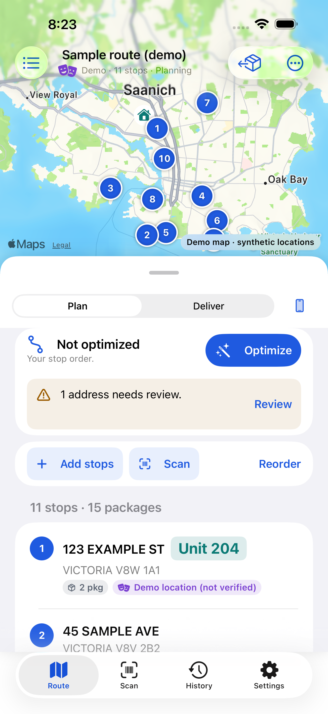
   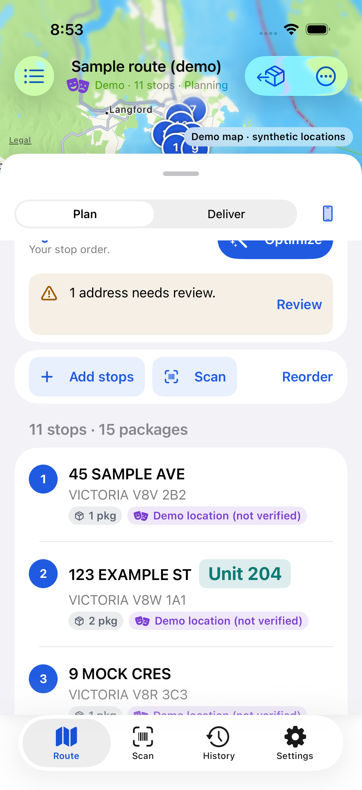

2. **Enter and import stops — healthy in the tested flow.** Manual entry, paste and native Files CSV
   selection lead to address review. CSV mapping preserves tracking and vehicle location columns;
   invalid rows remain visible and are skipped. Duplicates are identified rather than silently
   added. Field captions stay visible after typing. The confirmation action stays below the form,
   and unresolved addresses have an explicit warning action. Stale address-check results cannot
   replace a more recent edit. Mapping previews can truncate; the reviewed address rows show the
   full value.

   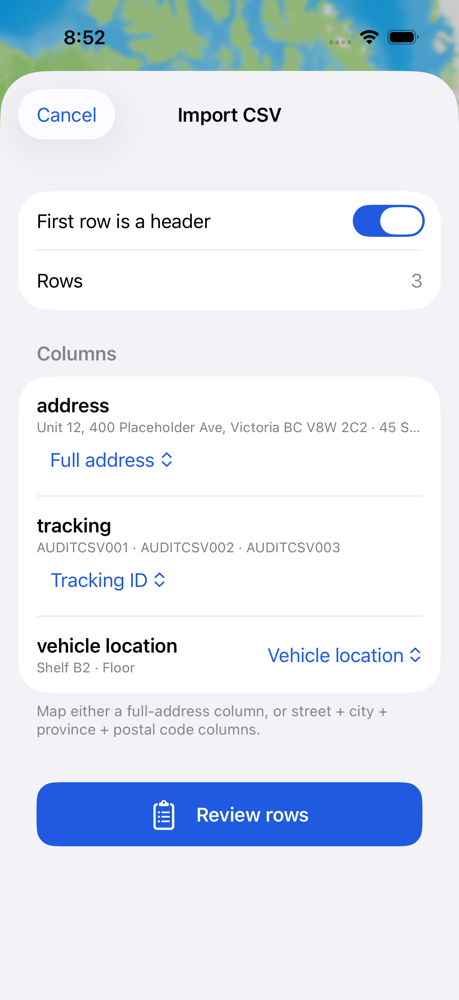
   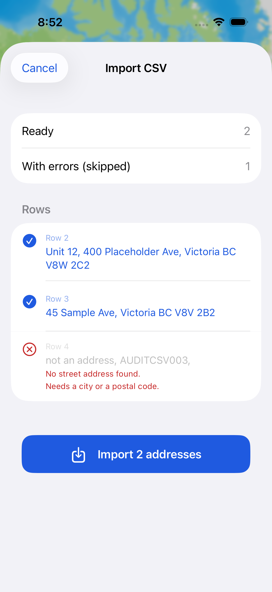
   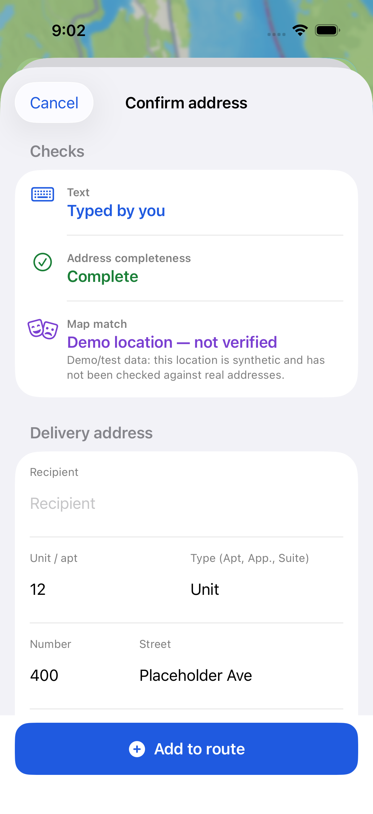

3. **Scan and photo intake — healthy for simulator-supported actions.** Importing the synthetic
   label runs real on-device Vision OCR, opens confirmation and adds a third package to the existing
   unit. Type, photo-picker cancellation, batch toggle and empty review queue work. Simulator now
   reports no camera directly and disables the shutter instead of presenting an unusable camera
   permission path. Camera status refreshes on returning from Settings. At accessibility sizes the
   fallback explanation scrolls while Import and Type remain available. Live scanning, torch and
   real camera permissions need a physical iPhone.

   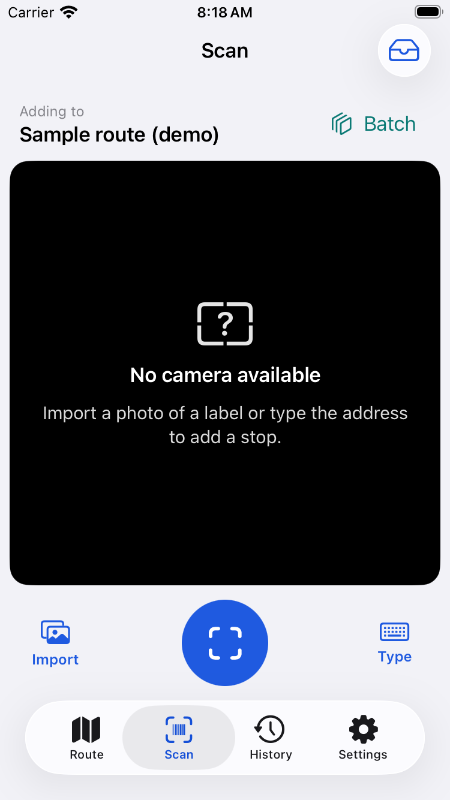
   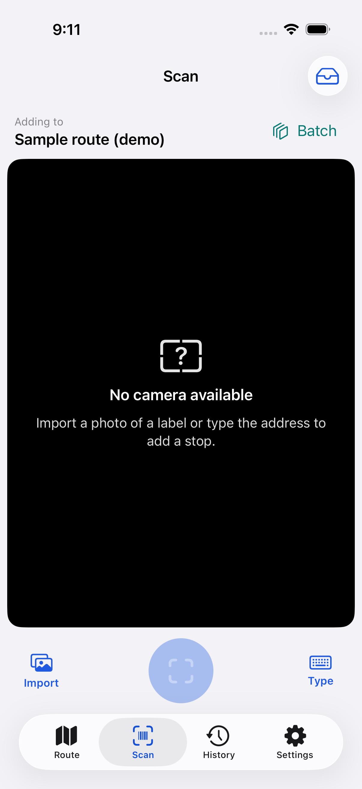
   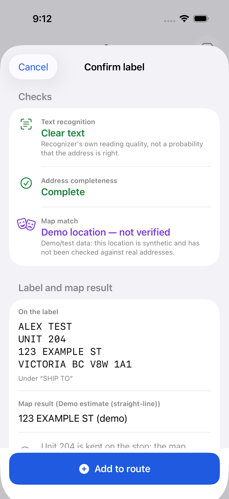

4. **Calculate and accept a plan — healthy with demo/emulator providers.** Calculate, preview,
   accept and keep-current-order work. Metrics adapt to width; acceptance and cancellation stay
   below the scrolling proposal. Stale proposals retain input validation. Route return-to-start
   changes persist. The local callable optimizer produced a job document and the applied revision
   matched the current server revision. Demo distances remain labelled straight-line estimates.

   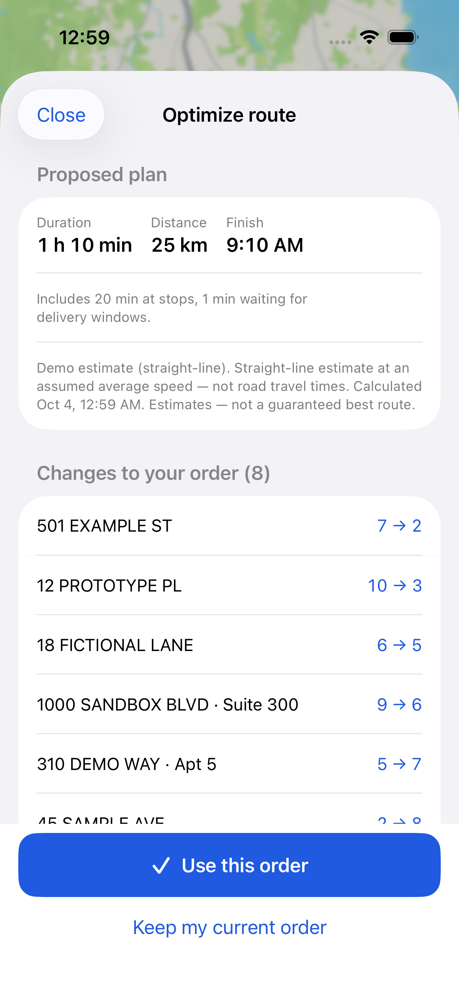
   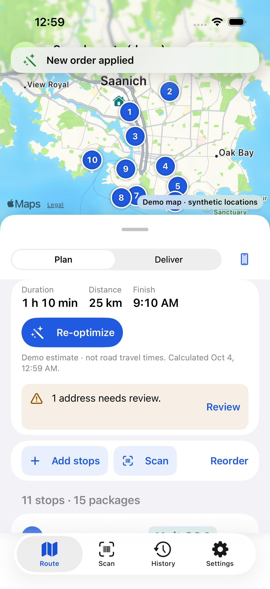

5. **Navigate and deliver — healthy in the tested flow.** Navigate, Delivered, Failed and Skip stay
   visible. The destination and unit are repeated beside these actions even when the stop card has
   scrolled away. Multi-package delivery supports partial outcomes; failure requires a reason;
   cancel records nothing. Undo returns the same next stop. Retry later and Exclude work, including
   exclusion Undo. Panel dragging cannot hide the delivery controls. Offline outcomes survive
   termination and relaunch. Apple Maps handoff and return do not mark a package delivered.
   Driver-placed coordinates take precedence over the typed street address, including rural pins.

   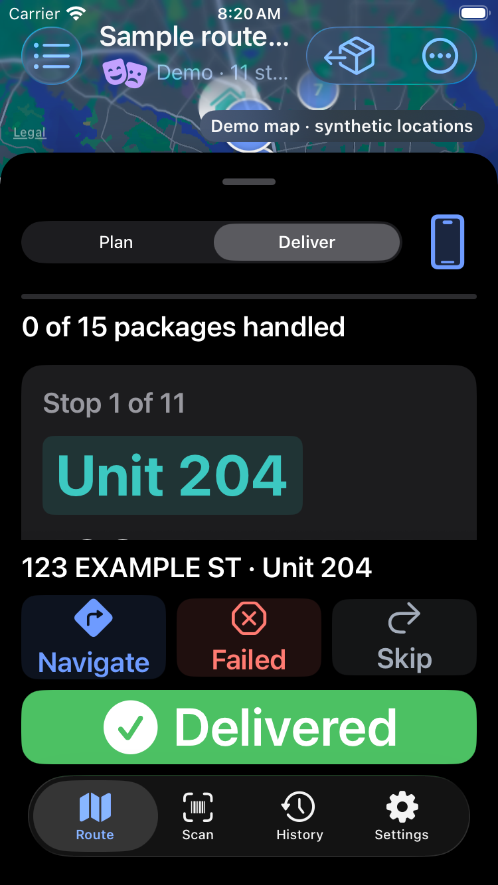
   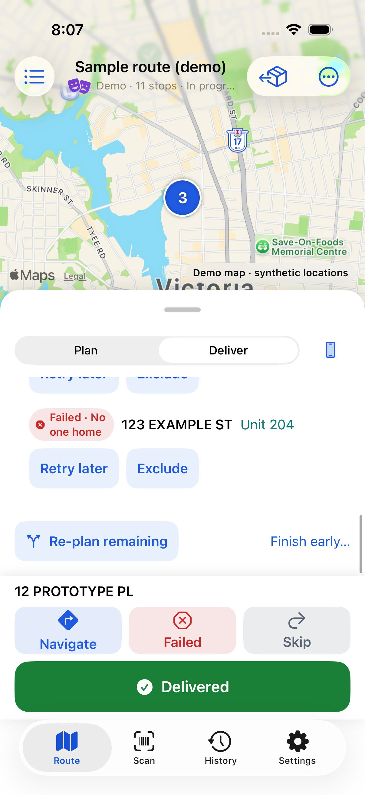

6. **Find packages and edit stops — healthy in the tested flow.** Finder results open the right stop.
   Cancelling a new package no longer creates it. Stop address editing, pin placement and moving,
   navigation-app choice, and soft delivery windows work. Notes save when leaving the editor;
   unchanged notes avoid unnecessary sync writes. Package removal offers an Undo inside the package
   section. Proof-of-delivery library import, viewing and deletion are checked separately from
   label OCR; SDK tests cover offline persistence, upload, download and deletion under storage rules.

   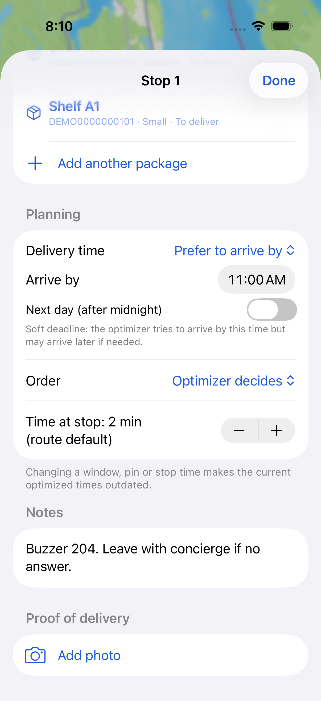
   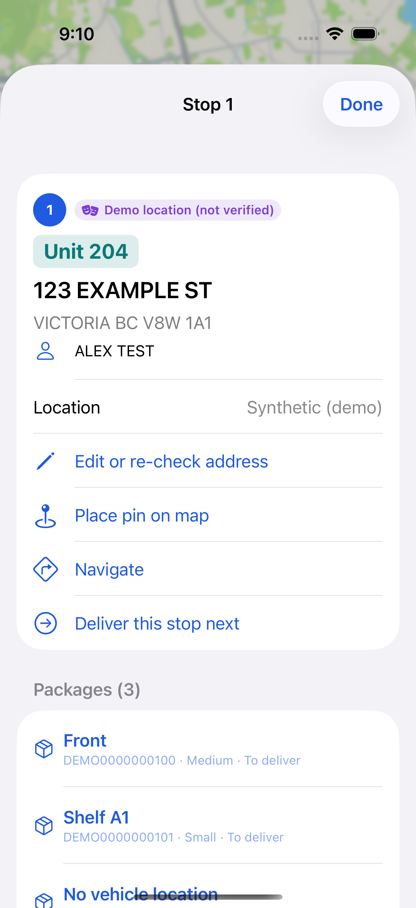
   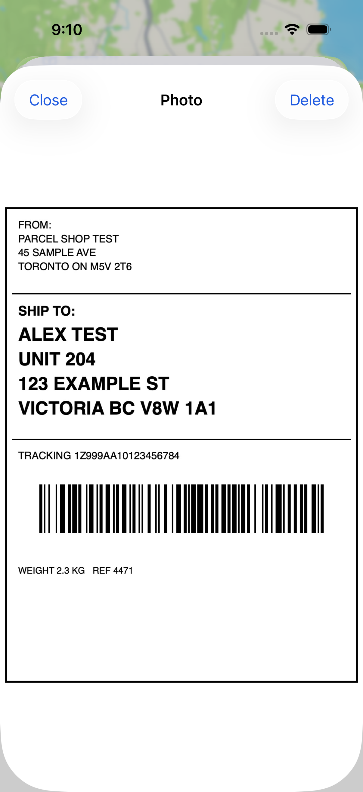

7. **Finish and review history — healthy in the tested flow.** Finish early requires an explicit
   choice, records the summary and returns to routes. History shows actual outcome counts and
   measured outcome times. Reopening or duplicating from History switches to the Route tab. Synthetic
   distance is labelled estimated straight-line distance. The empty state explains where routes go.

   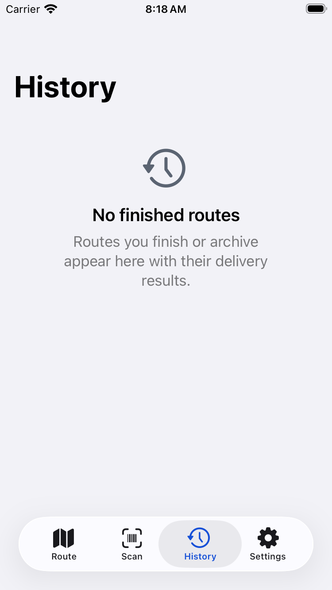
   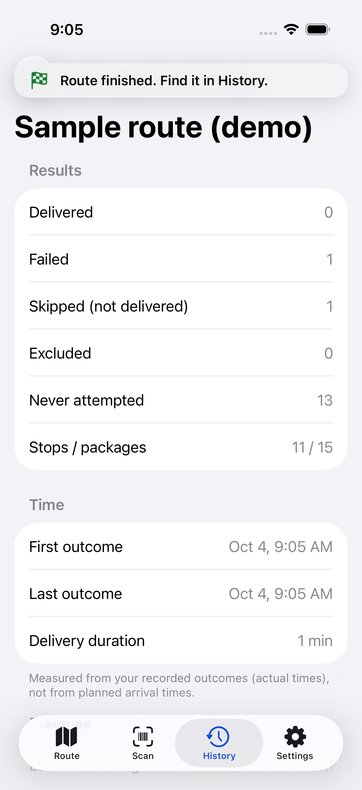

8. **Settings, account and sync — healthy against local emulators.** Navigation and units, privacy
   explanation, email account creation, verification link, rejected wrong password, sign-in and
   sign-out work. SDK tests exercise account deletion/session invalidation, cross-user access denial,
   rejected-write recovery and append-only outcomes. Account controls were tested with synthetic
   emulator accounts. Settings grows and scrolls at large text sizes.

   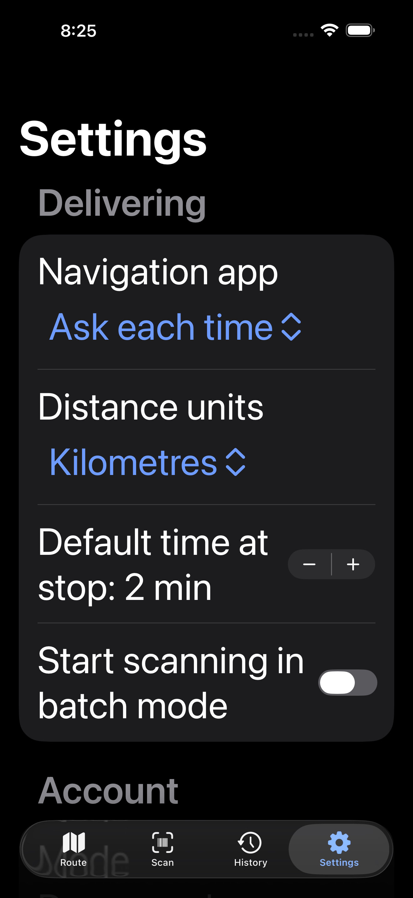
   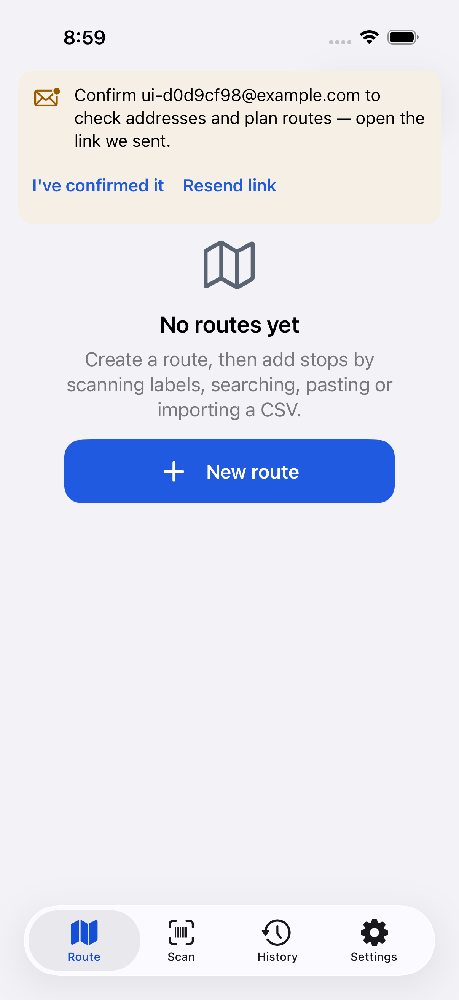

## Highest-impact findings fixed

| Finding | Effect before | Change |
|---|---|---|
| Small planning viewport | Stops were hidden behind summaries and warnings | Larger panel, compact warning and adaptive button rows |
| Cramped plan metrics | Distance and duration wrapped awkwardly | Metrics adapt to available width, Optimize has its own space |
| Long confirmation forms | Add required hunting through the form | Persistent captions and a footer action |
| Delivery content obscured controls | Address could scroll out of view or panel could collapse | Pinned destination/unit, adaptive footer, minimum delivery height |
| Cancel new package | Package existed despite cancellation | Create only on Save |
| Package finder dismissal | Selecting a match lost the detail sheet | Replace the parent sheet with the selected stop |
| Finish/reopen state | Finished route stayed selected; reopened route remained behind History | Clear finished selection and switch to Route on reopen |
| Pin navigation | Rural/corrected pin could still navigate to the typed address | Hand off driver coordinates and omit stale Google place ID |
| Stop removal | Destructive swipe had no quick recovery | Undo restores stops/packages while preserving later route edits |
| Camera availability in Simulator | Unusable camera/permission controls | Explicit hardware fallback and disabled shutter |
| Saved photo preview | Tapping a saved photo failed to open the viewer | Present the viewer from the stop screen; retain it and show errors if deletion fails |
| Accidental package removal | No recovery within the stop sheet | Inline Undo preserves package data and later route edits |

Baseline screenshots show the initial viewport and metric problems:

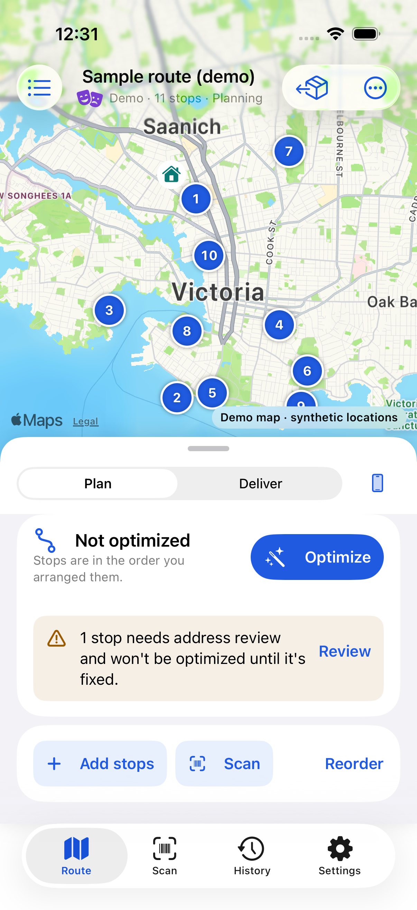
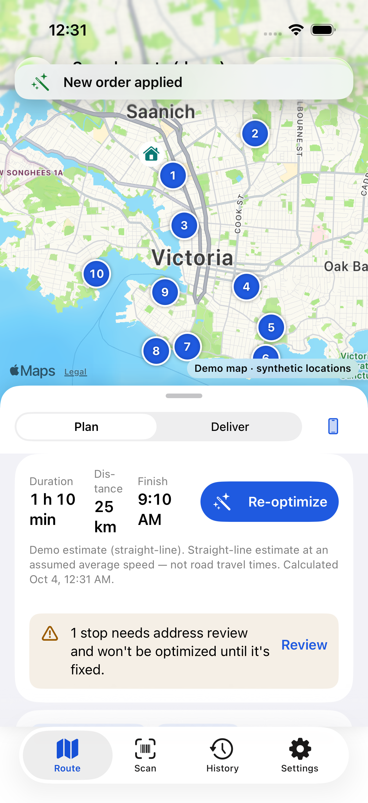

## Validation

| Check | Result | Evidence |
|---|---|---|
| App tests, including 7 Firebase SDK emulator tests | 30 passed in 7 suites | `build/results.noindex/AuditEmulatorReady.xcresult` |
| Account, address-suggestion and full-stack UI flows | 3 passed | Same result bundle |
| Server inspection of simulator-created routes/jobs/outcomes | All 17 checks passed across two routes | `/tmp/parcelpilot-emulator-server-verification.log` |
| Domain package, including Vision label fixtures and pin-navigation regression | 93 passed | `/tmp/parcelpilot-domain-final.log` |
| Cloud Functions unit tests | 42 passed | `/tmp/parcelpilot-functions-tests.log` |
| Firestore and Storage rules tests | 21 passed | `/tmp/parcelpilot-rules-tests.log` |
| Cloud Functions integration tests | 30 passed | `/tmp/parcelpilot-functions-integration.log` |
| Primary-screen screenshot matrix | 8 runs passed, 40 captures | `build/results.noindex/Screens-1791127016-*.xcresult` |

The broad final driver run (`AuditDriverFinal.xcresult`) passed 19 workflows, skipped the dedicated
screenshot-matrix helper, and exposed one photo-preview failure. After correcting presentation,
`AuditPhotoPackageFinal.xcresult` passed all 3 affected UI workflows and all 7 RouteStore tests,
including the extended package-undo regression. All 20 distinct driver workflows therefore have
passing verification. `AuditConfirmationFinal.xcresult` also passed the imported-label flow after
forcing the confirmation sheet to full height. The test checks that the footer is hittable and
inside the screen; the accepted screenshot above confirms it visually.

The test harness asserts actual saved addresses, order changes, package counts, undo outcomes,
selected tabs and server records; it does not treat merely opening a screen as success. Native
picker timing and offscreen drag targets were corrected in the harness without weakening those
assertions. Eight screenshot-matrix runs passed independently.

## Remaining evidence limits

Physical camera capture, live barcode/address scanning, torch, real-world driving, traffic-aware
production routing, Google Maps app handoff and production Apple/Google OAuth were not verified.
Waze is not currently a navigation option. Spoke's advertised functionality was used as a reference
from its [official App Store listing](https://apps.apple.com/ca/app/spoke-route-planner/id1198232244);
this pass does not claim that every advertised Spoke feature is implemented or that ParcelPilot
outperforms it in real deliveries.

Screenshots show wrapping, visibility, large-text layout and icon/text cues. They do not establish
VoiceOver traversal, Switch Control, exact contrast ratios, or full accessibility compliance. Large
text on compact screens still requires scrolling for lengthy stop details, planning summaries and
empty-state explanations. The delivery address and primary actions remain visible independently.

All audit commits use Nikhil Dhillon as sole author and committer. No push or deployment was made.
