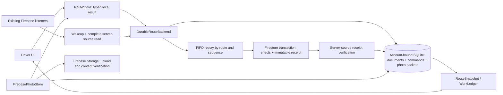
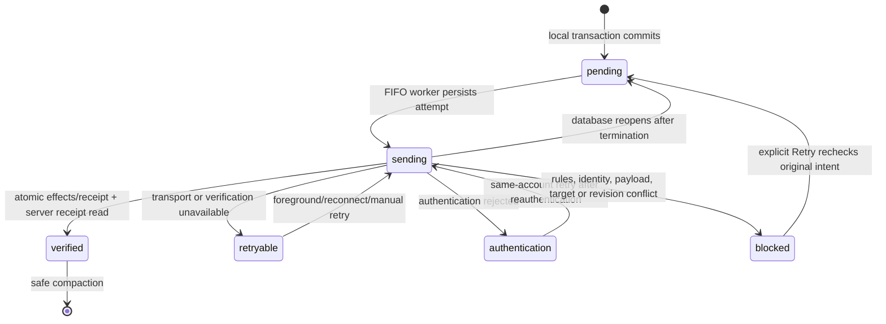

# WP2 — Protected active-route persistence and durable command outbox

Implementation handoff, 2026-10-06. Scope: WP2 only. No Firebase deployment, production resource creation, or WP3 implementation.

## 1. Architecture chosen

App sessions now use `DurableRouteBackend` around the existing Firebase or demo adapter. `ActiveRoutePersistence` uses native SQLite3 in Application Support, independently of Firestore's managed cache. Domain documents, selected-route metadata, command sequences, commands, and queued Firebase photo packets share one database. A logical action can contain several bounded remote commands; their local effects and envelopes commit in one SQLite transaction.

The database stores individual typed route/stop/package/task/outcome/photo documents rather than rewriting one route blob. It does **not** store task completion states. `RouteSnapshot` reconstructs `WorkLedger`; packages remain delivery definitions, independent work remains `LocationTask`, and outcomes remain the only disposition history.



SQLite access and observable publication remain on `MainActor`; Firebase transaction callbacks use a nonisolated immutable replay plan. There is one replay worker, not a second general networking framework. Settings, unaccepted scan drafts, geocoding calls, and optimizer jobs retain their existing persistence boundaries.

The database uses WAL, `synchronous=FULL`, checked transactions, and `fullfsync=ON`. Files use [complete-until-first-user-authentication protection](https://developer.apple.com/documentation/foundation/fileprotectiontype/completeuntilfirstuserauthentication), and the operational directory is [excluded from backup](https://developer.apple.com/documentation/foundation/urlresourcevalues/isexcludedfrombackup). Data is unavailable before the first unlock after a device restart; failed access never produces an operational success acknowledgement. This uses platform protection, without custom encryption. SQLite's [synchronous guarantees](https://www.sqlite.org/pragma.html#pragma_synchronous) remain subject to platform and storage behavior.

## 2. Durability contract

For an app-session `.committed(LocalCommitAck)` result:

- The SQLite transaction has committed the stable command IDs, account/route binding, sequence, replay payloads, and resulting protected documents together.
- The restored reducer can reproduce the locally displayed work disposition. UI success, haptics, dismissal, scan counts, review-draft removal, and Undo dismissal follow this boundary.
- Ordinary loaded-route actions need no network round trip. Addresses, accepted sequence, notes, packages/barcodes, task instructions, outcomes, route constraints/revisions, navigation targets, next-stop calculation, and progress remain available after process termination and offline relaunch.
- Firebase photo capture success means bytes and queue intent have committed together. Upload success alone does not release bytes. Photos remain optional and their synchronization state is separate from work completion.
- A local acknowledgement establishes saved intent, **not** verified cloud synchronization. A later rejection preserves the local result and command, and surfaces recovery. The server can temporarily contain only the verified prefix of a multi-command logical action.

The guarantee covers platform storage that survives application termination and restart. It does not cover uninstall, device loss, physical storage failure, explicit confirmed account/demo-data deletion, unaccepted intake drafts, background execution while the app is suspended, or causal ordering across devices. There is no exactly-once distributed-system claim.

`LocalCommitResult.failed` is typed as storage, corruption, unsupported schema, ownership, or conflict. Failed local transactions return no successful outcome IDs, publish no completion, and preserve the previous materialization and outbox. Retrying the tap remains safe. A sync-status write failure has a separate message explaining that already-recorded work is preserved.

Raw `FirestoreRouteBackend.commit` remains a compatibility transport API for existing fixtures; its SDK queueing result is **not** the production durability boundary. `AppServices` installs the protected wrapper in Firebase, emulator, and demo sessions.

## 3. Command lifecycle and reconciliation



Each command has schema version, stable ID, UID, route ID, monotonic per-route sequence, timestamp, label, operations, base revision, known route creation/update identity, definition baselines, payload digest, lifecycle state, and last error. The digest excludes mutable lifecycle fields. SQL keys are checked against decoded identities; document checksums, command payload digests, database integrity, schema, selection, and sequence consistency are validated on restoration.

Commands replay in route sequence. A transient/authentication failure stops that attempt's dependent suffix; blocked intent prevents further mutations to that route. Other routes remain independent unless the store itself is quarantined. Same-account reauthentication can retry the head without spinning; changed account identity prevents replay before and after asynchronous boundaries.

Firestore effects and `users/{uid}/routes/{routeID}/mutationReceipts/{commandID}` are written in one transaction. A matching receipt is recognized before checking the now-advanced revision. Receipt verification uses `.server`, exact meaningful receipt fields, and the payload digest. Outcomes, Undo timestamps, targets, task associations, definition baselines, route creation/update identity, and revision are checked before new application. Collisions or stale baselines are blocked, rather than overwritten. [Firestore transaction retries and online requirements](https://firebase.google.com/docs/firestore/manage-data/transactions) affect transport only; local recording remains independent.

Missing network, timeout, cache data, unavailable verification, or an unknown callback result cannot verify a command. If the server applies a transaction before the device records its receipt, replay recognizes the same receipt and does not duplicate outcomes or increment revision again.

Replay first obtains a server-source receipt to establish connectivity and recognize a previous application. Callback validation failures are confirmed with an available server read before becoming blocked; loss of that read leaves intent retryable. Firestore [truncates stored dates to microseconds](https://firebase.google.com/docs/firestore/manage-data/data-types). Timestamp comparisons allow less than two microseconds for that truncation plus observed Date/JSON binary conversion error, while all non-date payload fields remain exact. This allowance is a wire-format tolerance, not permission for clock drift; the SDK fixtures exercise the fractional boundary that previously caused false replacement conflicts.

Listeners remain useful wakeups. Firebase aggregate callbacks do not directly replace protected operational data. Complete server-source reads check root identity/version before and after fetching all collections. Pending intent prevents replacement. Remote reconciliation preserves known immutable outcome history and voids. A replaced/deleted route or conflicting history is preserved locally and surfaced. A newer verified closed route is readable, but new work requires explicit reopening.

Verified envelopes compact on startup and during replay at 64 verified commands or 2 MiB of verified command JSON. Photo-referenced receipt envelopes remain until their packets settle. Domain outcome history is never compacted by this operation. SQLite reuses freed pages; WAL/checkpoint overhead means compaction does not promise an immediate smaller file. Server receipts remain durable for idempotent replay.

## 4. Files changed for WP2

Paths below identify WP2 responsibility areas; the working tree also contains pre-existing WP1 and design changes.

| Responsibility | Repository-relative paths |
|---|---|
| Transactional persistence and replay coordinator | `ParcelPilot/Services/Core/ActiveRoutePersistence.swift` (new), `ParcelPilot/Services/Core/DurableRouteBackend.swift` (new) |
| Typed acknowledgements and existing command APIs | `ParcelPilot/Services/Core/Backend.swift`, `ParcelPilot/Services/Core/RouteStore.swift`, `ParcelPilot/Services/Core/ServiceProtocols.swift` |
| Firebase receipts, complete reads, legacy status facade | `ParcelPilot/Services/Firebase/FirestoreRouteBackend.swift`, `ParcelPilot/Services/Firebase/SyncJournal.swift`, `firebase/firestore.rules` |
| Protected photo packets and upload/deletion verification | `ParcelPilot/Services/Firebase/FirebasePhotoStore.swift`, `ParcelPilot/Services/Demo/DemoServices.swift` |
| Legacy local reader and checked mutation/reset | `ParcelPilot/Services/Demo/LocalRouteBackend.swift` |
| Account-scoped bootstrap, restoration, logout/delete | `ParcelPilot/App/AppServices.swift`, `ParcelPilot/App/AppCoordinator.swift`, `ParcelPilot/App/AppConfiguration.swift`, `ParcelPilot/Services/Firebase/FirebaseSession.swift` |
| Checked delivery, Undo, progress, proposal acceptance, edits | `ParcelPilot/DesignSystem/Components.swift`, `ParcelPilot/Features/Deliver/DeliveryPanel.swift`, `ParcelPilot/Features/Workspace/RouteWorkspaceView.swift`, `ParcelPilot/Features/Stops/StopDetailView.swift`, `ParcelPilot/Features/Optimize/OptimizeSheet.swift` |
| Checked intake transfer and route-level actions | `ParcelPilot/Features/Scan/ScanModel.swift`, `ParcelPilot/Features/AddStops/AddressConfirmationView.swift`, `ParcelPilot/Features/AddStops/ImportViews.swift`, `ParcelPilot/Features/Routes/RouteEditorView.swift`, `ParcelPilot/Features/Routes/RouteTab.swift`, `ParcelPilot/Features/History/HistoryView.swift` |
| Minimal storage/sync error and retention copy | `ParcelPilot/Features/Root/MainTabView.swift`, `ParcelPilot/Features/Settings/SettingsView.swift` |
| Contract, photo, SDK and rules regression tests | `ParcelPilotTests/DurableRouteContractTests.swift` (new), `ParcelPilotTests/PhotoDurabilityTests.swift` (new), `ParcelPilotTests/FirestoreBackendEmulatorTests.swift`, `firebase/tests/firestore.rules.test.ts` |
| Handoff | `docs/WORK_PACKAGE_2.md` |

No arrival/location implementation was added. WP2 does not alter the Swift package's work reducer or Google optimizer design.

## 5. Migration

- **Legacy demo JSON:** additive import into protected typed documents. Frozen pre-WP1 delivery-only JSON defaults absent tasks to an empty collection; frozen WP1 task/outcome history remains readable. Source JSON is retained. Corrupt/unsupported legacy sources quarantine instead of becoming empty routes. SQLite becomes the app's operational writer; legacy JSON is not a competing completion ledger.
- **Legacy journal:** marker and imported command envelopes commit atomically; interrupted/repeated import is restart-safe. Existing operation/event identity is retained. Historical revision coverage is represented as unknown (`baseRevision=-1`), never fabricated. Original JSON remains available. Old payload-free rejection notices remain in that source file; they do not represent replayable driver intent.
- **Explicit legacy recovery:** Retry requires a complete online server generation and the oldest saved change first. It atomically establishes a new baseline, applies the original intent with a narrow revision invalidation, and updates the original command ID/sequence into modern pending state. Other legacy changes remain blocked and preserved until the earlier change verifies. Failed recovery rolls back every change. This does not prove that a historical send covered a revision.
- **Legacy photos:** stable-ID import from Application Support and the old temporary-directory fallback, with a per-source transactional marker. Original manifests/files survive import. Missing files become visible pending entries; corrupt manifests are preserved and block unsafe capture. Original proof bytes are removed only after required remote verification, or explicit confirmed deletion.
- **Selected route:** protected selection wins over automatic first-open-route selection. Selecting an uncached remote route preserves the previous complete selection until the new generation is pinned. List-level rename/archive/reopen first load a complete route; offline attempts to edit an uncached route fail explicitly without quarantining healthy loaded work.
- **Versioning:** database `user_version=1`, command schema 1; an empty schema-zero database upgrades transactionally. Unsupported future versions preserve bytes and require a compatible app. Existing route/task/outcome wire formats remain readable; no destructive history migration.
- **Account lifecycle:** production, emulator, and demo namespaces are separate, as are UID-owned databases. Logout suspends replay/uploads and retains protected work. Another UID receives a separate graph. Successful confirmed cloud-account deletion explicitly erases operational rows and legacy photo/journal data; cleanup failures surface. Leaving demo retains data; explicit demo erase is checked.

Downgrading to an old binary cannot safely expose SQLite-only unsynchronized work. Preserve the database and use a compatible build; do not roll back by deleting protected data or pretending the old cache/journal contains it.

## 6. Failure behavior

| Failure | Driver/data behavior |
|---|---|
| Offline/timeout/unknown verification | Continue locally after commit; command remains pending/retryable. No completion rollback or false cloud acknowledgement. |
| Local transaction/storage/protection error | No success, haptic, dismissal, or intake transfer. Previous route/outbox survive; free space/unlock/retry. |
| Sync-status write failure | Already-recorded work remains protected; visible message and subsequent retry. |
| Corrupt database/document/command, invalid key/checksum, future schema | Preserve original bytes, quarantine, expose recovery, prevent unsafe new operational writes. No automatic reset. |
| Authentication expiry | Intent preserved, distinguishable authentication state, same-account reauthentication/retry. |
| Different UID/logout | Replay and owner-sensitive reads/writes stop; original work remains bound to its account. |
| Rules rejection, mismatched event ID, revision/definition conflict, missing target | Preserve blocked command/local work and stop dependent replay. Explicit Retry rechecks the same baseline; it cannot force overwrite. Persistent conflicts need operator reconciliation of original data. There is no generic conflict editor/export UI in WP2. |
| Remote deletion/replacement/incomplete history | Protected route preserved with explicit recovery state. Unavailable reads are not deletion evidence. |
| Missing proof/upload failure/metadata rejection | Show pending proof/error; retain durable packet/bytes when available. Optional proof failure does not undo delivery. |
| Photo deletion failure | Persist cleanup intent; do not lose the remote-object reference on termination. Verify metadata deletion and object absence before clearing the packet. |

Photo upload verification compares server-managed MD5/size/type against local bytes, with downloaded SHA-256 verification when MD5 is unavailable. Client-written metadata alone is insufficient proof. Firebase documents MD5 as server-managed [Storage metadata](https://firebase.google.com/docs/reference/swift/firebasestorage/api/reference/Classes/StorageMetadata).

## 7. Verification

Final checks on the implementation:

| Check | Result |
|---|---|
| `ParcelPilotKit` | 127 tests, 15 suites, 0 failures |
| Backend unit | 61 tests, 0 failures |
| Backend typecheck | Passed |
| Backend emulator integration | 38 tests, 0 failures |
| Firestore + Storage rules | 38 + 3 = 41 tests, 0 failures |
| Affected app + real Firebase SDK | 101 tests, 13 suites, 0 failures |
| Focused driver UI | 3 tests, 0 failures |
| Offline UI relaunch repetitions | 2 executions, 0 failures |
| Whitespace | `git diff --check` passed |

Core coverage includes three offline deliveries, pickup/defer, termination/reopen without SDK cache, Retry/completion, ordered replay, repeated replay, and a second restart. The real Firebase SDK version of that sequence verifies seven stable receipts/outcomes. Other cases cover transaction fault boundaries, applied-before-local-receipt recovery, wrong account, auth recovery, storage errors, checksums/schema/key corruption, malformed listeners, remote deletion, immutable payload collisions, stale revisions/definition baselines, frozen migrations, several legacy changes, failed scan/Undo acknowledgements, optional-photo failure/deletion, and large-route measurements.

Commands used (run from repository root unless `cd` is shown):

```sh
cd Packages/ParcelPilotKit
swift test
```

```sh
cd firebase/functions
npm test
npm run lint
FIRESTORE_EMULATOR_HOST=127.0.0.1:8180 \
FIREBASE_AUTH_EMULATOR_HOST=127.0.0.1:9099 \
GCLOUD_PROJECT=demo-parcelpilot npm run test:integration
```

```sh
cd firebase
FIRESTORE_EMULATOR_HOST=127.0.0.1:8180 \
FIREBASE_STORAGE_EMULATOR_HOST=127.0.0.1:9199 npx vitest run --dir tests
```

Auth/Firestore/Storage emulators use `demo-parcelpilot`, ports 9099/8180/9199. Rules/integration tests clear that disposable database; run them separately from SDK tests.

```sh
TEST_RUNNER_PP_EMULATOR=1 xcodebuild test \
  -project ParcelPilot.xcodeproj -scheme ParcelPilot \
  -destination 'platform=iOS Simulator,id=6415CDD2-BEC2-40AF-ACCB-0E60185BF981' \
  -only-testing:ParcelPilotTests \
  '-skip-testing:ParcelPilotTests/FirestoreBackendEmulatorTests/emailAccount()' \
  -parallel-testing-enabled NO -collect-test-diagnostics never -enableCodeCoverage NO \
  -derivedDataPath /tmp/parcelpilot-wp2-derived \
  CODE_SIGN_IDENTITY=- CODE_SIGN_STYLE=Manual DEVELOPMENT_TEAM=

# Run separately, without the app-unit runner's PP_EMULATOR environment.
xcodebuild test -project ParcelPilot.xcodeproj -scheme ParcelPilot \
  -destination 'platform=iOS Simulator,id=6415CDD2-BEC2-40AF-ACCB-0E60185BF981' \
  -only-testing:ParcelPilotUITests/DriverFlowUITests/testPartialDeliveryFailureCancelAndExcludeUndo \
  -only-testing:ParcelPilotUITests/DriverFlowUITests/testSkipUndoAndRetryUndo \
  -only-testing:ParcelPilotUITests/DriverFlowUITests/testOfflineDeliveryPersistsAfterRelaunch \
  -parallel-testing-enabled NO -collect-test-diagnostics never -enableCodeCoverage NO \
  -derivedDataPath /tmp/parcelpilot-wp2-derived \
  CODE_SIGN_IDENTITY=- CODE_SIGN_STYLE=Manual DEVELOPMENT_TEAM=

xcodebuild test-without-building -project ParcelPilot.xcodeproj -scheme ParcelPilot \
  -destination 'platform=iOS Simulator,id=6415CDD2-BEC2-40AF-ACCB-0E60185BF981' \
  -only-testing:ParcelPilotUITests/DriverFlowUITests/testOfflineDeliveryPersistsAfterRelaunch \
  -test-iterations 2 -parallel-testing-enabled NO -collect-test-diagnostics never \
  -enableCodeCoverage NO -derivedDataPath /tmp/parcelpilot-wp2-derived \
  CODE_SIGN_IDENTITY=- CODE_SIGN_STYLE=Manual DEVELOPMENT_TEAM=
git diff --check
```

The existing `emailAccount()` callable test is excluded because the Functions emulator is not running; backend handlers are covered by the separate 38 integration tests. This is not a claim that the whole UI suite or callable end-to-end matrix ran. Build warnings include pre-existing Swift concurrency warnings and unused App Intents metadata extraction. No physical-device, arrival, location, or battery certification is claimed.

An intermediate combined app/SDK/UI run had two SDK test failures from the timestamp tolerance defect and one UI failure before finding the Skip control. The timestamp defect is fixed and covered by boundary fixtures. The UI failure did not reproduce in the separate final driver suite or either of two additional offline-relaunch executions; its cause is not established. This remains a Simulator automation caveat, rather than evidence that the entire UI matrix is green. A separate photo-test equality failure was corrected to compare the stored generation before and after recovery, while checking the original timestamp within its serialization precision.

## 8. Measurements

Final simulator observation: Atlas iPhone 17, iOS 26.5, Xcode SDK 27.0, ad-hoc signed debug build. Fixture: **500 stops, 750 packages, 50 pickups, 100 acknowledged delivery commands**.

| Observation | Measured |
|---|---:|
| Initial protected pin | 79.72 ms |
| Driver-command local acknowledgement, mean | 152.39 ms |
| Local acknowledgement, p95 / maximum | 170.14 / 239.26 ms |
| Database reopen plus route restoration | 145.87 ms |
| Mock replay including local lifecycle/receipt writes | 100 commands in 5.591 s; 17.89 commands/s |
| Initial DB + WAL + SHM | 836,176 bytes |
| After 100 pending commits, DB + WAL + SHM | 1,341,584 bytes |
| Pending command JSON payload total | 118,528 bytes |
| After verified-envelope compaction, DB + WAL + SHM | 3,088,296 bytes; 0 command rows; 100 outcomes retained |

These are observations, not product SLOs. Mock throughput excludes Firebase latency, radios, physical flash behavior, and contention from real navigation. An earlier measured version averaged 508.63 ms per command; profiling identified redundant full materialization reads and per-byte `String(format:)` digest formatting. Removing those costs preserved validation. Successive final-code runs averaged 115.68–152.39 ms; the table uses the last complete passing app/SDK run. No route-sized blob is rewritten on each command.

## 9. Deferred items and limits

- Explicit execution sessions, arrival sensing, voice, BC geocoding, task-entry/arrival UI, navigation changes, and optimizer redesign remain outside WP2.
- Multi-device leases, old-client rollout enforcement, distributed causal ordering, and a general conflict editor remain later work. Blocked intent is preserved; Retry does not silently rebase modern conflicts.
- Unaccepted review drafts and noncritical user settings retain their existing boundaries. They are not part of the loaded-route acknowledgement guarantee.
- Synchronization resumes on session start, foreground, reconnect, or explicit retry. No new background-execution entitlement or scheduler was added.
- The pre-existing maximal route-document rules-budget limitation recorded in WP1 remains; WP2 does not certify every maximally populated route shape.
- Receipt rules are additive and tested locally. They must be deployed through the project's normal reviewed release process before a WP2 production writer can synchronize. No deployment was performed here.

## 10. WP3 handoff

WP3 must use `RouteStore` and the typed acknowledgement boundary for operational mutations. It must not write independent completion flags, replay directly through raw Firestore, or bypass `WorkLedger`. Add execution-session persistence to the same checked transactional boundary with an additive schema migration; preserve current selected-route recovery and account binding.

Presence/arrival must remain separate from outcomes. Newly introduced session actions must not claim success before a local commit, remove unresolved commands on logout, or invalidate a protected route merely because a listener/cache is absent. Keep external navigation and explicit proposal acceptance intact. Use `currentReadIssues`, `persistenceIssue`, command lifecycle, and photo state for the existing correctness/error gates. Respect the pending-command fence during remote refresh and the per-route FIFO sequence during replay.

WP2 stops here. WP3 has not been started.
