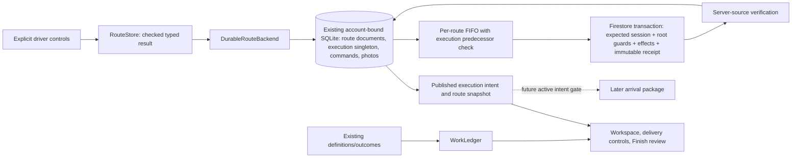
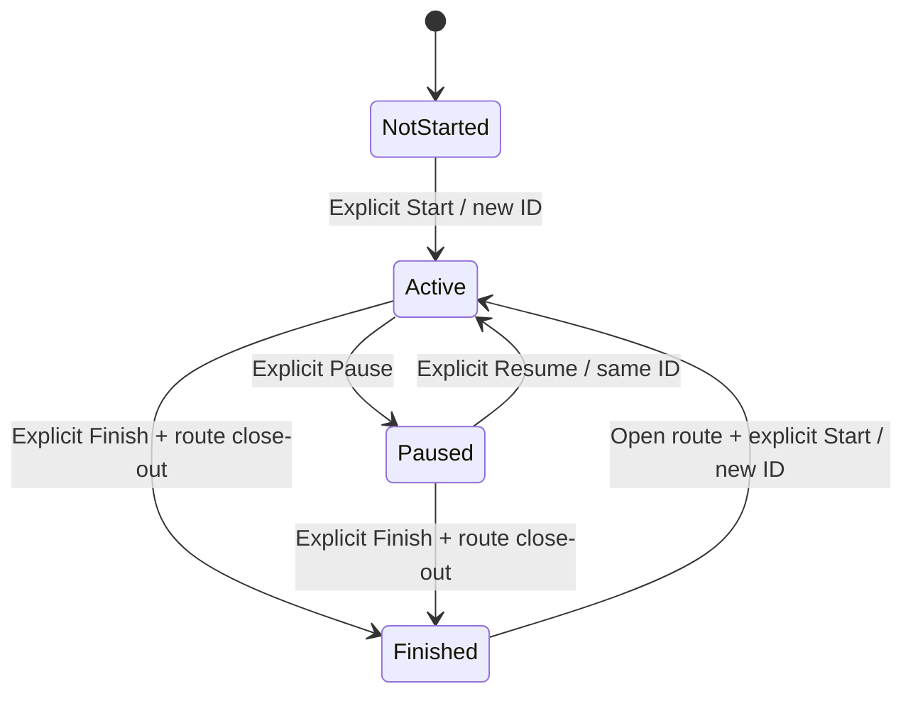

# WP3 — Explicit route execution session

Implementation handoff, 2026-10-06. Scope: WP3 only. WP4 has not started. No production Firebase deployment or new production resource was performed.

## 1. Execution-session architecture

`RouteExecutionSession` is one account-current record, persisted in the existing protected SQLite database. It contains `id`, `routeID`, `schemaVersion=1`, `state`, `startedAt`, `changedAt`, and `transitionCount`. The owner is the existing database/Firebase account boundary. There is no second work reducer, lifecycle ledger, or persistence service.

One singleton enforces the Phase 1 driver model without adding multi-route concurrency. A finished record remains available until a later explicit Start replaces it with a new session ID. Previous route/work history remains in its existing documents. Pending commands retain exact lifecycle intent; verified command envelopes compact under WP2's existing policy. Immutable Firebase receipts remain the replay evidence. This is deliberately not an unbounded lifecycle-history product.



Sources of truth stay separate:

| Concern | Authority |
|---|---|
| Driver execution intent on this iPhone | Protected execution singleton, published only after checked SQLite commit |
| Route selection | Existing protected `selected` metadata; browsing can change it independently |
| Accepted stop order | Existing stop sequences, applied proposal metadata, and explicit current-order choice |
| Work state/progress | `WorkLedger`, reconstructed from packages/tasks/outcomes |
| Route close/archive/history | Existing `Route` fields and derived summary |
| Cloud synchronization | WP2 commands, Firestore transaction and verified immutable receipt |
| Future arrival eligibility | `RouteStore.executionSession` active state, with separate future consent/authorization gates |

Legacy route `status=active` and `startedAt` remain readable and retain existing delivery compatibility semantics. They never authorize execution or location services. Neither selection, proposal acceptance, outcomes nor navigation creates a session.

## 2. State machine

Absence of a session means not started. `finished` is a durable terminal state for that session ID.



| Action | Preconditions and effect | Repeat/invalid behavior |
|---|---|---|
| Start | Complete protected open route, safe work/read state, nonempty stop list, usable remaining destination where required pending work exists, accepted current proposal or explicit current-order choice. Creates active session, count 0. | Active same route: acknowledged no-op, no new command. Paused same route: instruct Resume. Another unfinished route: refuse and provide Return. Closed/unreadable/stale screen: refuse. |
| Pause | Active session for this route; retain ID/start time and increment count. | Already paused: acknowledged no-op. Missing/finished session: refuse. |
| Resume | Paused session for this route; retain ID/start time and increment count. | Already active: acknowledged no-op. Missing/finished session: refuse. |
| Finish | Existing close-out review; unsupported/unreadable/unassigned work blocks. Pending/deferred required work needs explicit confirmation. Atomically closes route and finishes its unfinished session. | Already finished/closed session: acknowledged no-op, including retained old view snapshots. No successful outcomes fabricated. |

The store chooses monotonically ordered lifecycle timestamps even when the device clock moves backward. `changedAt` plus the count identifies the latest explicit action; `startedAt` remains immutable. Domain/replay validation compares wire timestamps within the established two-microsecond serialization tolerance and all other fields exactly.

Session controls do not bump optimizer input revisions. Work/input mutations keep existing revision behavior. An accepted proposal or explicit route edit during execution preserves the session ID/state.

Existing explicit close-out of a route that was never started remains available. It does not fabricate a historical execution session. Reopening a finished route does not reactivate the old session; a new Start creates a new ID.

## 3. Durability behavior

A successful operational acknowledgement means the session materialization and replayable command have committed together in WP2's checked SQLite transaction. Start/Pause/Resume do not change route settings or work history. Finish includes the session transition, route completed metadata/summary, and selected-route cleanup in the same local transaction.

UI mode, success toast, or sheet dismissal follows local acknowledgement. Firebase acknowledgement is separate. Local storage failure rolls back session, route and command together and leaves the previous UI state. Ordinary offline/pending/retryable synchronization does not block locally valid transitions. Existing read, ownership, unsupported-schema, quarantine and blocked/authentication command gates remain enforced.

The singleton compare-and-set prevents a second unfinished route locally. A blocked/authentication execution command fences later lifecycle changes account-wide, even after a locally acknowledged Finish on another route. It never deletes that saved intent. Replay also checks the explicit expected-session predecessor so offline Finish A → Start B cannot send B ahead of A merely because B sorts first.

Optional proof upload failure remains independent of work disposition and execution completion; unfinished proof stays in the existing durable photo queue.

## 4. Restoration

- Cold launch restores active/paused execution and its complete protected route before requiring a server read. It prefers that route operationally without changing the separate saved-selection pointer solely for restoration.
- Browsing another route changes selection, not execution. Return to running/paused route is available in the list, another route's workspace, and the loading/unavailable screen for an uncached route.
- Background/foreground only drives existing process/sync/navigation-return concerns. It does not Pause/Resume. Termination does not Finish.
- Logout suspends the old graph and retains owner-bound data. Same-account reauthentication rebuilds from protected storage; another account receives its own database and cannot read/control/replay the prior session.
- Confirmed account deletion uses the existing checked local erase, now including the execution row. The existing backend recursive user deletion already includes the additive remote singleton.
- A server-confirmed missing, replaced, incompatible or conflicting execution record does not erase local intent. It preserves data and surfaces the existing recovery state. Unavailable reads remain unavailable, never not-started evidence.
- Selecting an uncached route retains WP2's complete-generation protection. No location service is restored or started by WP3.

## 5. Driver UX

- **Before start:** Start route. A current accepted proposal starts directly. Otherwise, the driver explicitly confirms Use current order and start; a stale/unaccepted proposal is never silently accepted.
- **Running:** small Route running status with Pause; normal navigation and explicit outcomes continue.
- **Paused:** unmistakable Route paused status and Resume route. Explicit work recording stays available.
- **All required work handled:** explicit Finish remains necessary. Failed is labeled unsuccessful, not completed successfully.
- **Finish review:** canonical completed/failed/excluded/pending/deferred counts plus every unfinished required obligation, with stop/unit and package or task identity. Optional work does not block Finish. Unsupported required work cannot be confirmed away. Finish preserves pending/deferred dispositions.
- **Archive:** an unfinished execution session must be explicitly finished first; raw/remote close/archive paths are guarded too. Routes continue to be archived, not physically deleted.

The existing `startDelivering` accessibility identifier is retained with the Start route label. New controls use `executionStatus`, `pauseExecution`, `resumeExecution`, `returnToExecutionRoute`, `confirmStartCurrentOrder`, and `confirmFinishRoute`.

An existing automatic map location request on Deliver appearance was removed because explicit Start must not request location permission or GPS. Existing driver-invoked map centering and optimization origin requests remain available. External Google/Apple navigation handoff is unchanged, and its return never changes execution or work state.

Minimal pilot events are a finite typed vocabulary for requests, locally acknowledged transitions, blocked work close-out, restoration, and sync failure/recovery. A default-off Settings toggle enables **on-device unified logging only**. Payloads contain state/disposition counts and enum error category; no account/route/task IDs, addresses, fine location, images, audio, tracking or free-form errors. No telemetry uploader, database, or operational ledger was added. WP11 owns remote pilot collection/retention. Manual Retry clears prior WP2 error state, so a subsequent recovery log may be absent; operational recovery remains verified independently.

## 6. Remote synchronization

Firebase adds `users/{uid}/execution/current`. This avoids growing the already budget-sensitive route document and gives account-wide compare-and-set semantics. `ExecutionSessionTransport` adds a strict server-source fetch capability; older test transports do not supply a misleading default nil.

`ChangeOp.transitionExecution(routeID, expected:session:)` carries the exact previous/current intent. It uses existing command IDs, account/route binding, per-route sequence, digest, root creation/update/revision guards and mutation receipts. Replay reads all required documents before writing. Duplicate receipts verify without applying the action again, even if an old Start replays after Finish. Finish and root close-out are one Firebase transaction. Raw SDK compatibility commits reject lifecycle operations.

Additive rules validate the singleton's shape and legal edges, bind ownership, preserve immutable session identity/start time, require open-route start/resume, and require finished-route close-out. Root rules reject archive/close orphaning of an unfinished session. Direct route deletion remains prohibited. Existing receipts are unchanged.

This provides one local unfinished session and one server singleton. It does not establish multi-device offline leases: competing offline devices can preserve conflicting local intent, and server compare-and-set rejects the loser without overwriting the winner. Distributed leases/rollout enforcement remain explicitly outside WP3.

Firebase documents transaction atomicity/read-before-write and rule `getAfter` validation with per-operation/transaction access limits: [Transactions](https://firebase.google.com/docs/firestore/manage-data/transactions), [Rule conditions](https://firebase.google.com/docs/firestore/security/rules-conditions). Existing populated-route close-out regressions remain in the local emulator matrix.

## 7. Files changed

Paths are repository-relative for portable implementation handoff. The working tree already contained WP1/WP2 and design changes; this list identifies WP3 edits, not every dirty file.

| Responsibility | Files |
|---|---|
| Domain and state validation | `Packages/ParcelPilotKit/Sources/ParcelPilotKit/Model/RouteExecutionSession.swift` (new) |
| Protected singleton, migration, command CAS and replay ordering | `ParcelPilot/Services/Core/Backend.swift`, `ActiveRoutePersistence.swift`, `DurableRouteBackend.swift` |
| Driver API, close-out and telemetry | `ParcelPilot/Services/Core/RouteStore.swift`, `ExecutionFinishReview.swift` (new), `PilotTelemetry.swift` (new) |
| Firebase and compatibility adapters | `ParcelPilot/Services/Firebase/FirestoreRouteBackend.swift`, `SyncJournal.swift`, `ParcelPilot/Services/Demo/LocalRouteBackend.swift` |
| Minimal UI | `ParcelPilot/Features/Workspace/RouteWorkspaceView.swift`, `Features/Deliver/DeliveryPanel.swift`, `Features/Routes/RouteTab.swift`, `Features/History/HistoryView.swift`, `Features/Settings/SettingsView.swift`, `Features/Map/RouteMapView.swift` |
| Domain/persistence/store/SDK tests | `Packages/ParcelPilotKit/Tests/ParcelPilotKitTests/ExecutionSessionTests.swift` (new), `ParcelPilotTests/ExecutionPersistenceTests.swift` (new), `ExecutionSessionTests.swift` (new), `ExecutionReplayTests.swift` (new), `DurableRouteContractTests.swift` |
| Driver UI tests | `ParcelPilotUITests/ExecutionSessionUITests.swift` (new), `DriverFlowUITests.swift`, `PlanningPanelUITests.swift` |
| Rules/tests | `firebase/firestore.rules`, `firebase/tests/firestore.rules.test.ts` |
| Handoff | `docs/WORK_PACKAGE_3.md` |

## 8. Migration

Protected database `user_version` advances 1 → 2 by adding a checksummed singleton execution table and committing the schema/version atomically. Empty schema-zero stores also reach 2. The migration fault seam verifies rollback before the version write; repeated opens are idempotent. A literal schema-1 fixture verifies legacy active/start fields, delivery history, unit/tracking identities and selection survive without a fabricated session. Existing pending command identities/digests remain unchanged.

Route/stop/package/task/outcome wire schemas and command/receipt schema 1 remain unchanged. No history is rewritten. New enum operations are additive. Unsupported future database/document versions preserve bytes and use WP2 quarantine.

An old WP2 binary rejects schema 2 rather than replaying lifecycle commands it cannot understand. Roll back with a compatible build while preserving the database; deleting local rows/cache to downgrade is unsafe. New rules require a reviewed deployment with the compatible release, which has not occurred in this task.

## 9. Tests

Existing WP1/WP2 tests are included where the changed store/replay/rules layers affect their contracts.

| Check | Result |
|---|---|
| ParcelPilotKit | 132 tests, 16 suites, 0 failures |
| App + real Firebase SDK | 133 tests, 16 suites, 0 failures |
| Final targeted store/build check | 14 session tests, 1 suite, 0 failures after the uncached-route Return addition |
| Firestore/Storage rules | 46 + 3 = 49 tests, 0 failures |
| Driver UI | 9 distinct tests across two final runs, 0 failures; includes offline termination/relaunch in all four session states. Browsing/Return also passed a final 1-test rerun on the rebuilt app. |
| Whitespace | `git diff --check` passed |

The 32 new app tests cover session state and checked writes, four lifecycle restarts, idempotent repeated controls, selection/execution independence, current/stale order acceptance, required/optional/unsupported close-out, explicit failed/deferred dispositions, archive/reopen, proposal acceptance during execution, account separation, retryable offline transition, typed telemetry, migration/frozen wire history, corruption/compaction, account-wide conflict fences, execution FIFO and actual Firebase CAS/receipts. The SDK also exercises server-applied Start → lost local receipt → offline database reopen → receipt verification without duplicate lifecycle effect. The five new Kit tests validate model transitions independently.

Commands (repository root unless a working directory is shown):

```sh
cd Packages/ParcelPilotKit
swift test
```

Disposable emulators only, `demo-parcelpilot`: Auth 9099, Firestore 8180, Storage 9199. Rules tests clear their disposable database and run separately from SDK tests.

```sh
cd firebase
./scripts-env.sh ./node_modules/.bin/firebase emulators:start \
  --only auth,firestore,storage --project demo-parcelpilot

FIRESTORE_EMULATOR_HOST=127.0.0.1:8180 \
FIREBASE_STORAGE_EMULATOR_HOST=127.0.0.1:9199 npx vitest run --dir tests
```

```sh
TEST_RUNNER_PP_EMULATOR=1 xcodebuild test \
  -project ParcelPilot.xcodeproj -scheme ParcelPilot \
  -destination 'platform=iOS Simulator,id=6415CDD2-BEC2-40AF-ACCB-0E60185BF981' \
  -only-testing:ParcelPilotTests \
  '-skip-testing:ParcelPilotTests/FirestoreBackendEmulatorTests/emailAccount()' \
  -parallel-testing-enabled NO -collect-test-diagnostics never -enableCodeCoverage NO \
  -derivedDataPath /tmp/parcelpilot-wp2-derived \
  -resultBundlePath /tmp/parcelpilot-wp3-app-final.xcresult \
  CODE_SIGN_IDENTITY=- CODE_SIGN_STYLE=Manual DEVELOPMENT_TEAM=

xcodebuild test -project ParcelPilot.xcodeproj -scheme ParcelPilot \
  -destination 'platform=iOS Simulator,id=6415CDD2-BEC2-40AF-ACCB-0E60185BF981' \
  -only-testing:ParcelPilotUITests/ExecutionSessionUITests \
  -only-testing:ParcelPilotUITests/DriverFlowUITests/testPlanOptimizeDeliverFinish \
  -parallel-testing-enabled NO -collect-test-diagnostics never -enableCodeCoverage NO \
  -derivedDataPath /tmp/parcelpilot-wp2-derived \
  -resultBundlePath /tmp/parcelpilot-wp3-ui-corrected.xcresult \
  CODE_SIGN_IDENTITY=- CODE_SIGN_STYLE=Manual DEVELOPMENT_TEAM=

xcodebuild test-without-building -project ParcelPilot.xcodeproj -scheme ParcelPilot \
  -destination 'platform=iOS Simulator,id=6415CDD2-BEC2-40AF-ACCB-0E60185BF981' \
  -only-testing:ParcelPilotUITests/DriverFlowUITests/testPartialDeliveryFailureCancelAndExcludeUndo \
  -only-testing:ParcelPilotUITests/DriverFlowUITests/testSkipUndoAndRetryUndo \
  -only-testing:ParcelPilotUITests/DriverFlowUITests/testOfflineDeliveryPersistsAfterRelaunch \
  -only-testing:ParcelPilotUITests/DriverFlowUITests/testNavigationReturnDoesNotDeliver \
  -only-testing:ParcelPilotUITests/PlanningPanelUITests/testHandleTapAndListButtonShareTheSamePosition \
  -parallel-testing-enabled NO -collect-test-diagnostics never -enableCodeCoverage NO \
  -test-timeouts-enabled YES -default-test-execution-time-allowance 180 \
  -maximum-test-execution-time-allowance 180 \
  -derivedDataPath /tmp/parcelpilot-wp2-derived \
  -resultBundlePath /tmp/parcelpilot-wp3-ui-regressions.xcresult \
  CODE_SIGN_IDENTITY=- CODE_SIGN_STYLE=Manual DEVELOPMENT_TEAM=

TEST_RUNNER_PP_EMULATOR=1 xcodebuild test \
  -project ParcelPilot.xcodeproj -scheme ParcelPilot \
  -destination 'platform=iOS Simulator,id=6415CDD2-BEC2-40AF-ACCB-0E60185BF981' \
  -only-testing:ParcelPilotTests/ExecutionSessionTests \
  -parallel-testing-enabled NO -collect-test-diagnostics never -enableCodeCoverage NO \
  -derivedDataPath /tmp/parcelpilot-wp2-derived \
  -resultBundlePath /tmp/parcelpilot-wp3-session-final.xcresult \
  CODE_SIGN_IDENTITY=- CODE_SIGN_STYLE=Manual DEVELOPMENT_TEAM=

xcodebuild test-without-building -project ParcelPilot.xcodeproj -scheme ParcelPilot \
  -destination 'platform=iOS Simulator,id=6415CDD2-BEC2-40AF-ACCB-0E60185BF981' \
  -only-testing:ParcelPilotUITests/ExecutionSessionUITests/testBrowsingAnotherRouteDoesNotSwitchExecution \
  -parallel-testing-enabled NO -collect-test-diagnostics never -enableCodeCoverage NO \
  -test-timeouts-enabled YES -default-test-execution-time-allowance 180 \
  -maximum-test-execution-time-allowance 180 \
  -derivedDataPath /tmp/parcelpilot-wp2-derived \
  -resultBundlePath /tmp/parcelpilot-wp3-browse-final.xcresult \
  CODE_SIGN_IDENTITY=- CODE_SIGN_STYLE=Manual DEVELOPMENT_TEAM=
git diff --check
```

SDK testing uses `TEST_RUNNER_PP_EMULATOR=1`; UI testing runs separately without that runner environment. The unchanged `emailAccount()` callable test is excluded because the Functions emulator is not running. No backend function logic changed in WP3, so the WP2 backend results are not presented as newly run WP3 tests. No whole-UI-matrix, physical-device, location or battery certification is claimed.

Initial builds caught actor annotations and test compilation issues. An intermediate 130-test runtime run found one restoration-selection mutation; the implementation was corrected and the final 133-test app/SDK run passed. Initial UI runs exposed duplicate confirmation accessibility matches and a decorative Pause icon matching the status query. The test selector now chooses the dialog button, and the product status text owns the accessibility ID while its icon is hidden. One initial legacy optimize-flow run timed out before optimization; the cause was not established. Its final rerun passed, followed by the five regression flows. Existing concurrency/App Intents/layout warnings remain; this is not a warnings-free claim.

Final logs/results: `/tmp/parcelpilot-wp3-kit.log`, `/tmp/parcelpilot-wp3-app-final.log`/`.xcresult`, `/tmp/parcelpilot-wp3-rules.log`, `/tmp/parcelpilot-wp3-ui-corrected.log`/`.xcresult` (4 tests), `/tmp/parcelpilot-wp3-ui-regressions.log`/`.xcresult` (5 tests), `/tmp/parcelpilot-wp3-session-final.log`/`.xcresult` (14-test final store/build check), and `/tmp/parcelpilot-wp3-browse-final.log`/`.xcresult` (1-test final UI recheck). Earlier failed logs remain in `/tmp`; they are not presented as passing verification.

## 10. Deferred behavior

WP3 adds no arrival sensing, geofences, Core Location monitoring, location entitlement/notification, task-entry/at-location production UI, voice, BC resolver, manifest expansion, navigation integration, optimizer redesign, regional packages, leases, distributed ordering, general conflict editor, or production deployment. There is no new background scheduler. Existing production-resource and physical-device limitations remain explicit.

## 11. WP4 handoff

WP4 pickup/checklist entry and at-location UI must use packages as delivery definitions, independent `LocationTask` definitions, outcomes as disposition history, and `WorkLedger` as the only reducer. Call the checked `RouteStore` APIs and preserve WP2's local acknowledgement and photo/outbox boundaries.

Use `executionSession`/`executionSession(for:)` for explicit driver intent; selected route, scene phase, accepted proposal, navigation and work outcomes cannot substitute for it. Paused work can still be explicitly recorded. Never auto-Start on first work or auto-Finish on last work. Use `finishReview` for close-out; optional work does not block, failed is unsuccessful, and pending/deferred required work stays visible until confirmed Finish.

Preserve immutable task identity, monotonic outcome handling, Undo/Retry, revision and stale-proposal safeguards, ownership gates, complete-generation selection, account-wide execution fences, and route archive protections. A later arrival service may observe active execution but must additionally own driver consent and location diagnostics; WP4 must not introduce location activation implicitly.
