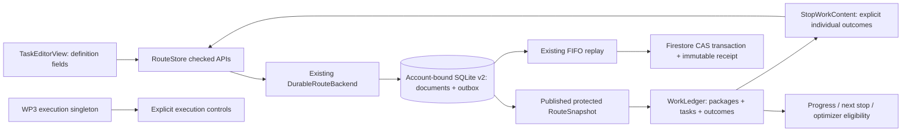

# WP4 — Pickup/checklist entry and unified stop work

Engineering handoff, 2026-10-06. This implementation follows **Run 4's scope and numbering**: production-quality task entry and manual at-location UI. The original blueprint's pickup/checklist slice had a later number. WP5 arrival sensing has not started. No production Firebase deployment or resource creation occurred.

## 1. Architecture

`StopWorkContent` renders one `RouteSnapshot.workLedger`, including delivery projections from packages. It is shared by the driving workspace, stop details and the identified-stop `StopWorkView`. Definitions stay in `LocationTask`; dispositions stay in the existing `TaskOutcome` history. There is no completion Boolean, second reducer, new persistence service or arrival state.



The published protected snapshot is the local operational authority after a checked transaction. Firestore receipts establish cloud acknowledgement separately. `WorkLedger` alone determines work state; accepted order remains in the existing route/stop fields, and `RouteExecutionSession` alone determines execution intent. Creating or performing work never starts or finishes execution.

## 2. Driver workflow

From stop details, use **Add pickup** or **Add checklist item**. In Deliver mode, **View stop work** opens the same work content directly with the owning route/stop identity. No arrival acknowledgement, GPS event, permission or session transition is needed.

Entry contains a short required description, optional instructions and a Required work toggle, defaulting to required. New items append their existing display rank after siblings. Save remains disabled for blank/overlong input; local failure leaves the editor open with an actionable error. Routine Save requires no extra confirmation.

A delivery-only stop retains the existing package-selection and one-tap Delivered action, partial delivery, failure, Skip, Undo and optional proof-photo flow. A mixed or task-only stop renders independent work controls inline. Pickups/checklists appear ahead of long delivery lists; every obligation is represented. The dedicated stop-work screen retains its identified stop when progress changes, making partial work and return visits inspectable.

| State | Presentation/action |
|---|---|
| Required pending | Prominent unfinished group; Delivered, Pick up or Done for the individual item |
| Failed | Failed — unsuccessful, reason and Retry |
| Deferred | Deferred — unfinished; Retry, with no optimizer visit until Retry |
| Optional pending/deferred | Separate Optional work group; same explicit actions |
| Completed/excluded | Collapsible handled history; Delivered/Picked up/Done versus Excluded labels |
| Unsupported | Visible review-required status; no unsafe action |

Routine success has one action and no mandatory note. Secondary menus hold Failed, Defer, Exclude, Edit and Undo last action where valid. Failure reuses the existing reason sheet with wording for delivery, pickup or checklist. Required work is never blanket-completed by another item's action.

## 3. Task editing

Mutable details are title, instructions, required status and existing `orderRank`. The editor deliberately exposes the first three fields; it retains display rank, without adding an ordering configuration screen. Identity, schema, owning stop, kind, package association and creation time remain fixed. Updated time advances monotonically.

Limits match the wire contract: title 120 characters, instructions 2,000, rank 0–1,000,000,000. Failure notes are limited to 500 characters and new work-UI failures require a reason. Legacy empty-title definitions remain readable and supported by the compatibility API; new entry requires a meaningful title.

An editor captures its definition baseline. A changed/deleted definition cannot be overwritten or resurrected by an old editor. Recording a standalone outcome from stale instructions is refused until the driver reviews the current definition.

Standalone Delete requires **no outcome history**, including voided history. A confirmation describes that removal. Pending create/edit commands do not prevent no-history deletion: the resulting create → edit → delete commands remain ordered, receipt-verified and durable. Completed, failed, deferred, excluded or retried items with history retain the definition. Their safe alternatives are Edit, Retry, Undo or explicit Exclude; no history is rewritten.

The protected store additionally rejects a low-level standalone deletion with outcome history. Existing stop removal is deliberately different: it removes associated definitions and preserves outcomes for the existing stop-removal Undo. Exact restoration and fresh route-copy identities remain supported. An unsafe low-level conflict uses WP2's quarantine rather than weakening its recovery gate.

## 4. Persistence and offline behaviour

New entry uses `saveTask`, `deleteTask` and typed `recordWorkAction`. Each success requires WP2's checked transaction to save definition/outcome effects, revision effects, command identity, baseline/digest and replay payload together. UI dismissal, status changes, haptics and Undo feedback follow local acknowledgement. Repeated outcomes are reducer no-ops, never duplicate events or new success feedback.

Task descriptions, instructions, required flags, ranks, outcomes and voids remain in protected route documents. Restart reconstructs the same ledger while offline. SQLite failure rolls back the logical action; pending/retryable cloud state permits normal local work. Ownership/read/schema/quarantine/blocked-command gates still prevent unsafe mutation. Finished routes reject task definitions, outcomes and Undo until explicitly reopened; reopening does not reactivate the prior session.

Synchronization reuses per-route FIFO, strict root revisions and document baselines, immutable receipts and server-source verification. Concurrent remote history rejects stale deletion; remote definition deletion rejects attempted resurrection. A server rejection preserves acknowledged local intent and its suffix for recovery. Duplicate receipt recognition neither duplicates outcomes nor restores an old definition. Optional proof photos retain their existing independent durable queue; WP4 introduces no task-specific proof requirement.

No database-version or Firestore-collection migration is required. SQLite remains version 2, task definitions version 1, generalized outcomes version 2 and commands/receipts version 1. Legacy route and package history is untouched.

## 5. Route integration

Required pending pickups/checklists make their existing stop eligible; optional-only work does not create a visit. Failure is handled unsuccessful. Deferral remains unfinished and excludes the required work from optimization until Retry. Retry/Undo restore eligibility through the same ledger. Identical coordinates never merge separate stop/unit identities.

Definition changes and dispositions advance `inputRevision`, staling prior proposals. They do not reorder accepted stops or accept a new proposal. Completing deliveries while pickup remains pending keeps the stop actionable. Creating work at a previously handled stop restores remaining-work eligibility. All-deferred work can remain the next review context under the existing next-stop fallback while staying optimizer-ineligible; WP4 preserves that behaviour.

Stop lists show pickup/checklist counts and search task descriptions. Deferred work is explicitly listed for review rather than placed under an unqualified Done heading. A Stop details **Deliver next** override warns once for that action when the current stop still has required pending work. **Continue to this stop** changes the explicit next target and preserves every unfinished disposition; **Keep current stop** cancels. This is an order-choice reminder, not sensed physical departure. Existing navigation handoff and proposal acceptance remain unchanged.

## 6. UX and accessibility

All work rows use native text/buttons/menus, practical 44-point controls and wrapping text. Required and optional work are explicitly labeled. State is conveyed with words and symbols as well as colour; failed and excluded work never share the successful green presentation. Full task instructions and mixed-stop access notes remain readable offline. Units remain in the owning stop's destination header.

After an acknowledged action, handled history expands where needed and accessibility focus targets the item's status text. Undo restores the prior canonical state and keeps that status available. Decorative status icons are hidden from accessibility to avoid duplicate identifiers. Controls have task-specific accessible names and stable test identifiers. Large text uses the existing collapsing-map/scroll layout; the work view adds no font-size cap.

Shared secondary controls use a borderless button style so SwiftUI cannot invoke sibling actions when they appear together in a Stop details list row. Covered workspace content is hidden from accessibility while its sheet is open. The handled-history identifier belongs to its label, preserving individual child identifiers. Overlong-input feedback is a regular form row rather than combined footer text.

Implementation follows Apple's [Accessibility guidance](https://developer.apple.com/design/human-interface-guidelines/accessibility), [SwiftUI accessibility modifiers](https://developer.apple.com/documentation/swiftui/view-accessibility) and [AccessibilityFocusState](https://developer.apple.com/documentation/swiftui/accessibilityfocusstate). Automated large-text/reachability coverage is distinguished from physical VoiceOver/Voice Control validation in the results below. Work interaction is intended while safely stopped.

[Large-text simulator evidence](wp4-verification/large-text-mixed-work.png) shows the actual mixed-work screen using fictional demo data. It was exported from the passing paused-session UI test and visually inspected.

WP3's default-off on-device logging gains finite task-kind/action, mixed-presentation, reminder and sync-failure events. It contains enum values and state counters, without addresses, instructions, notes, tracking numbers, account/task/route IDs, audio or location. There is no remote telemetry uploader or extra ledger; WP11 owns remote pilot collection. Settings describes both work and session logging.

## 7. Rollout protection

`AppMode.generalizedWorkAvailability` is immutable for the service graph: demo/emulator allow creation; production requires compatibility review. There is no production feature toggle in UserDefaults or pilot logging. Launching emulator mode points at the existing disposable emulator configuration, not production enablement.

The store gate covers new definitions through entry, the compatibility API, prepared changes and route copies, preventing alternate UI paths from bypassing creation protection. Exact restoration evidenced by the protected deletion-command baseline is allowed as Undo of known work. Known compatible obligations remain visible and can be edited/dispositioned; unsupported work fails explicitly. The compatibility release gate, old-client enforcement and distributed leases remain later work. No production writes or deployment were performed during verification.

## 8. Files changed

These paths identify WP4 changes; the checkout already contained WP1/WP2/WP3 and design changes.

| Responsibility | Repository-relative paths |
|---|---|
| Shared stop-work UI | `ParcelPilot/Features/Stops/StopWorkView.swift` (new), `ParcelPilot/Features/Stops/StopDetailView.swift` |
| Definition editor | `ParcelPilot/Features/Stops/TaskEditorView.swift` (new) |
| Driving/planning integration | `ParcelPilot/Features/Deliver/DeliveryPanel.swift`, `ParcelPilot/Features/Deliver/FocusDeliveryViews.swift`, `ParcelPilot/Features/Workspace/RouteWorkspaceView.swift` |
| Checked CRUD/outcome APIs and rollout gate | `ParcelPilot/Services/Core/RouteStore.swift`, `ParcelPilot/App/AppConfiguration.swift`, `ParcelPilot/App/AppServices.swift` |
| Protected identity/history safeguards | `ParcelPilot/Services/Core/ActiveRoutePersistence.swift` |
| Minimal pilot logging | `ParcelPilot/Services/Core/PilotTelemetry.swift`, `ParcelPilot/Services/Core/DurableRouteBackend.swift`, `ParcelPilot/Features/Settings/SettingsView.swift` |
| Store/replay tests | `ParcelPilotTests/TaskEntryStoreTests.swift` (new), `ParcelPilotTests/TaskDefinitionReplayTests.swift` (new), `ParcelPilotTests/FirestoreBackendEmulatorTests.swift` (explicit development availability in emulator fixture) |
| UI tests | `ParcelPilotUITests/StopWorkUITests.swift` (new), `ParcelPilotUITests/DriverFlowUITests.swift` (scrolling to package details below work; layout-roundoff tolerance) |
| Handoff/evidence | `docs/WORK_PACKAGE_4.md`, `docs/wp4-verification/large-text-mixed-work.png` (new) |

No ParcelPilotKit, optimizer, backend function, rules, location service, entitlement or permission contract was changed by WP4.

## 9. Tests

| Check | Result |
|---|---|
| ParcelPilotKit | **132 tests, 16 suites passed** |
| App tests with Firebase emulators | **154 tests, 18 suites passed**; one explicit unchanged Functions-dependent exclusion below |
| Firebase SDK/emulator subset included above | **38 tests passed**: backend 12, durable replay 11, execution replay 9, new task replay 6 |
| New protected-store coverage included above | **15 tests passed**; production gate, stale editors, fault rollback, history, ownership and sessions |
| Current Firestore/Storage rules | **49 tests passed**: Firestore 46, Storage 3 |
| Driver UI | **17 unique targeted flows passed**: five new work flows plus 12 existing regressions; initial final batch 15/17, corrected focused rerun 2/2 |
| Whitespace | `git diff --check` clean; checked again at handoff |

The six new SDK tests cover the requested offline sequence, restart with an empty SDK cache, receipt replay, create → edit → delete ordering, concurrent server history, remote task deletion, rejection, local failure and account isolation. The 15 store tests cover pickup/checklist-only stops, separate units sharing coordinates, optional eligibility, partial mixed work, Retry/Undo, repeated outcomes, revisions, copy/removal restoration and closed-route gates. The new UI flows exercise production controls against the real protected demo database, with simulated connectivity disabled; cloud effects are independently verified by the SDK tests.

Run from the repository root unless the command specifies a directory. The disposable emulator uses `demo-parcelpilot`; no production project is involved.

```sh
# Terminal 1, from firebase/ (stopped after verification)
./scripts-env.sh ./node_modules/.bin/firebase emulators:start \
  --only auth,firestore,storage --project demo-parcelpilot

# From Packages/ParcelPilotKit/
swift test

# From firebase/
FIRESTORE_EMULATOR_HOST=127.0.0.1:8180 \
FIREBASE_STORAGE_EMULATOR_HOST=127.0.0.1:9199 \
./scripts-env.sh ./node_modules/.bin/vitest run --dir tests

# From the repository root
TEST_RUNNER_PP_EMULATOR=1 xcodebuild test \
  -project ParcelPilot.xcodeproj -scheme ParcelPilot \
  -destination 'platform=iOS Simulator,id=6415CDD2-BEC2-40AF-ACCB-0E60185BF981' \
  -only-testing:ParcelPilotTests \
  '-skip-testing:ParcelPilotTests/FirestoreBackendEmulatorTests/emailAccount()' \
  -parallel-testing-enabled NO -collect-test-diagnostics never -enableCodeCoverage NO \
  -derivedDataPath /tmp/parcelpilot-wp2-derived \
  -resultBundlePath /tmp/parcelpilot-wp4-app-final.xcresult \
  CODE_SIGN_IDENTITY=- CODE_SIGN_STYLE=Manual DEVELOPMENT_TEAM=

xcodebuild test-without-building \
  -project ParcelPilot.xcodeproj -scheme ParcelPilot \
  -destination 'platform=iOS Simulator,id=6415CDD2-BEC2-40AF-ACCB-0E60185BF981' \
  -only-testing:ParcelPilotUITests/StopWorkUITests \
  -only-testing:ParcelPilotUITests/ExecutionSessionUITests \
  -only-testing:ParcelPilotUITests/DriverFlowUITests/testPlanOptimizeDeliverFinish \
  -only-testing:ParcelPilotUITests/DriverFlowUITests/testPartialDeliveryFailureCancelAndExcludeUndo \
  -only-testing:ParcelPilotUITests/DriverFlowUITests/testSkipUndoAndRetryUndo \
  -only-testing:ParcelPilotUITests/DriverFlowUITests/testOfflineDeliveryPersistsAfterRelaunch \
  -only-testing:ParcelPilotUITests/DriverFlowUITests/testNavigationReturnDoesNotDeliver \
  -only-testing:ParcelPilotUITests/DriverFlowUITests/testLargeTextDeliverView \
  -only-testing:ParcelPilotUITests/DriverFlowUITests/testPanelSwipesStopRemovalUndoAndNextStop \
  -only-testing:ParcelPilotUITests/DriverFlowUITests/testFindPackageOpensDetailsAndCancelPackageAdd \
  -only-testing:ParcelPilotUITests/PlanningPanelUITests/testHandleTapAndListButtonShareTheSamePosition \
  -parallel-testing-enabled NO -collect-test-diagnostics never -enableCodeCoverage NO \
  -test-timeouts-enabled YES -default-test-execution-time-allowance 240 \
  -maximum-test-execution-time-allowance 240 \
  -derivedDataPath /tmp/parcelpilot-wp2-derived \
  -resultBundlePath /tmp/parcelpilot-wp4-ui-final.xcresult \
  CODE_SIGN_IDENTITY=- CODE_SIGN_STYLE=Manual DEVELOPMENT_TEAM=

# Rebuild and rerun the two corrected legacy visibility/roundoff checks
xcodebuild test \
  -project ParcelPilot.xcodeproj -scheme ParcelPilot \
  -destination 'platform=iOS Simulator,id=6415CDD2-BEC2-40AF-ACCB-0E60185BF981' \
  -only-testing:ParcelPilotUITests/DriverFlowUITests/testPanelSwipesStopRemovalUndoAndNextStop \
  -only-testing:ParcelPilotUITests/DriverFlowUITests/testFindPackageOpensDetailsAndCancelPackageAdd \
  -parallel-testing-enabled NO -collect-test-diagnostics never -enableCodeCoverage NO \
  -test-timeouts-enabled YES -default-test-execution-time-allowance 240 \
  -maximum-test-execution-time-allowance 240 \
  -derivedDataPath /tmp/parcelpilot-wp2-derived \
  -resultBundlePath /tmp/parcelpilot-wp4-ui-regression-final2.xcresult \
  CODE_SIGN_IDENTITY=- CODE_SIGN_STYLE=Manual DEVELOPMENT_TEAM=

git diff --check
```

`emailAccount()` needs the Functions emulator for email-verification/paid-feature gating, which was not started for this task/UI slice. This unchanged account test was explicitly excluded; no WP4 Functions contract changed. Backend Functions tests were not rerun, and no full UI-suite pass is claimed. The current rules suite was run separately from SDK tests because it resets emulator documents.

Raw verification records: `/tmp/parcelpilot-wp4-kit.log`, `/tmp/parcelpilot-wp4-rules.log`, `/tmp/parcelpilot-wp4-app-final.log`, `/tmp/parcelpilot-wp4-ui-final.log`, `/tmp/parcelpilot-wp4-ui-regression-final2.log` and the result bundles above. The earlier targeted run also passed all **21 new store/SDK tests** in `/tmp/parcelpilot-wp4-targeted.xcresult`; they are included again in the final 154-test app run.

During verification, tests caught and resolved a rollout-gate restoration-baseline key error, inherited disclosure identifiers, List automatic-button sibling activation and feedback covering sheet navigation. Harness fixes addressed fixture execution start/SDK timestamp baselines, editing the actual text field, directional scrolling, regular-row validation feedback and 0.001-point tolerance for CGRect roundoff. Tests never substitute successful assertions for a failed durable acknowledgement.

The final 17-flow UI batch passed **15**, including every new work flow, and failed two old assumptions: a lazily rendered package header was checked before scrolling past the work section, and an exact 44-point frame was represented as 43.99999999999997. After correcting those checks (and a test-helper compile error), the focused rerun passed **2/2**. Thus every selected flow has a passing final result; this is not a claim that one 17-test invocation or the complete UI suite passed. New paused-session reachability assertions cover primary, menu and Add controls at 44 points with only floating-point roundoff tolerance.

## 10. Remaining limitations

Production creation remains intentionally disabled pending compatible-client rollout review. Physical VoiceOver/Voice Control and road-device ergonomics are not certified by simulator automation. No GPS, background-location or battery certification is needed or claimed for WP4.

Arrival sensing/departure detection, voice, BC resolution, inventory, cross-stop dependencies, task windows, signatures, required photos, leases, remote telemetry and production deployment remain deferred. A manually selected next target does not infer presence or physical departure.

## 11. WP5 handoff

Present `WorkspaceSheet.work(stopID)` → `StopWorkView(routeID:stopID:)` for an identified stop in the fully selected route. The same `StopWorkContent` already serves manual and driving access; WP5 must reuse it. Opening it records no arrival, execution transition or outcome. Route/stop identity remains the ownership boundary, including separate apartments sharing coordinates.

Future arrival assistance may run only with persisted `RouteStore.executionSession.state == .active` plus its separately owned consent, authorization and location-service conditions. Paused/finished intent must stop automatic services while allowing legitimate manual work on an open route. Selecting, accepting a proposal, navigating, opening work, recording an outcome and foregrounding cannot substitute for explicit execution intent.

Continue using `WorkLedger`, checked store APIs, protected local acknowledgement, revision safeguards, existing Undo/Retry, owner/recovery gates and `finishReview`. Arrival may surface obligations; it must never complete them. WP5 has not begun.
